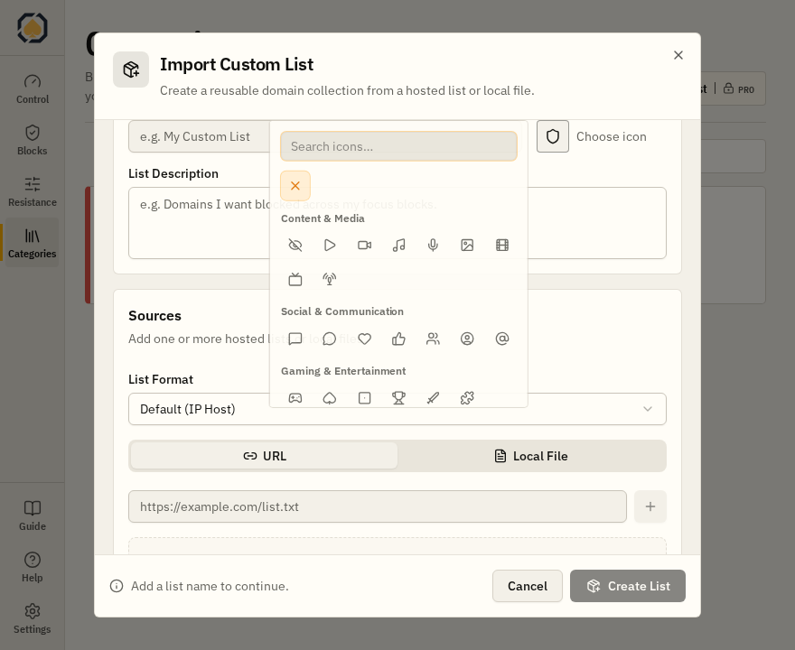
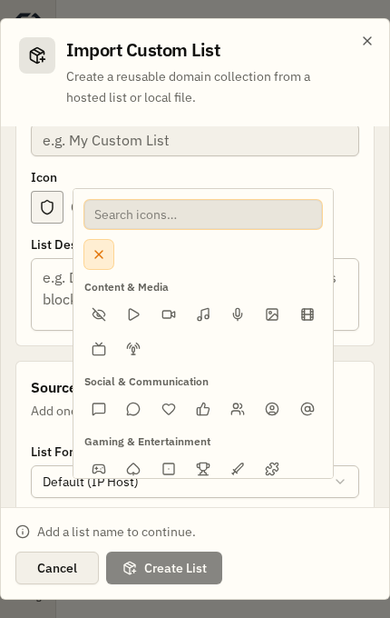

# ACE App — audit UI/UX (5 novembre 2026)

**Ambito.** Control, Network Blocks (editor e Schedule), Resistance, Categories e Custom Lists, Settings, Guide, Inspector, dialog e selettore icone. Verifica nella WebView Tauri con WebdriverIO e nei componenti Svelte reali con Playwright; nessuna modifica di regole o enforcement durante gli screenshot. Identità guida: `docs/ui-identity.md`.

## Problemi corretti

| Problema | Correzione | Commit |
| --- | --- | --- |
| Inspector Create/Edit Block tagliato sopra | Pannello ancorato al bordo alto e test geometrico nativo | `4c82d37` |
| Azioni Upgrade to Pro incoerenti | Componente comune: funzione visibile, “Upgrade to Pro” su hover/focus, indicatore Pro | `71ffc1b` |
| Get Pro in debug apre produzione | Sito locale `http://localhost:5173` in debug, pubblico in release | `73927fe` |
| Upgrade Pro non aggiorna contenuti | Refresh entitlement e aggiornamento di metadata Site Pack e script Resistance nel motore | `acf0e8d` |
| Icone Resistance assenti e poi monocromatiche | Loghi bundled da `simple-icons`, colori del marchio e fallback | `5d8e100`, `d473ab1` |
| Pro ufficiali confusi con Custom Lists | Distinzione con `isRemote` anche per ID locali generati; stato “Pro required” per Free | `36d0dd3` |
| “Checking legal acceptance” in attesa del server | Lettura iniziale locale e refresh remoto separato | `5f450b1` |
| Popover Icon Picker fuori dal dialog e coperto dal footer | Posizionamento a sinistra nel modulo import, z-index e collision padding | `f7490ee` |

## Screenshot di verifica

Screenshot acquisiti su componenti reali in browser, senza dati personali o account:

**Desktop 880 × 720**

**Finestra compatta 430 × 680**

## Verifiche e limiti

- `bun run check`: zero errori/warning Svelte; 99 test unitari; 11 Playwright.
- `cargo check -p ace-engine --bin ace-engine --locked` riuscito; test Rust mirati su cache Pro e origine dei Site Pack superati.
- **Da validare in ambiente completo:** checkout Free → Pro con server/CDN reali e download effettivo degli script; i test confermano i contratti, non un acquisto reale.
- **Da ripetere dopo ricompilazione/riavvio del motore:** test nativo sul blocco iniziale legale. La correzione è compilata e testata a livello unitario, ma l'istanza nativa già in esecuzione era precedente alla modifica.

## Backlog emerso dall'audit

- L'editor Network Block contiene molti controlli nella stessa scheda Blocking. Valutare una gerarchia più chiara dopo test d'uso.
- La creazione dei Custom Site Pack offre già la scelta dell'icona, ma manca il comando per modificarla successivamente. **Non sono state aggiunte icone alle righe Site Pack**: farlo richiederebbe completare anche il flusso di modifica dell'icona.
- `AppSidebar.svelte` e `SidebarAccountWidget.svelte` sono componenti legacy non montati dal layout corrente: non modificati.

I fix sono separati in commit per consentire rollback selettivi. Le altre modifiche già presenti nella working tree sono state lasciate intatte.
