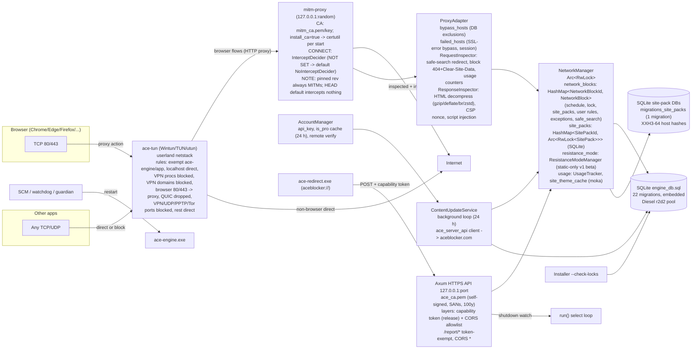

# Ace Engine — Architecture and simplification review

> **Status update (2026-09-02, tracking removal):** the recommendations in
> this dated review were partially executed the same week. SIMP-01 (delete
> the dynamic resistance engine), SIMP-04 (delete the tracking-script
> pipeline), SIMP-05 (ProgressTracker) and SVC-13 were implemented by the
> tracking-removal change (engine commit `8e5fca5`): the dynamic ladder,
> probation fields, `PunishmentMode::Dynamic`, the tracking download
> pipeline, the report receivers, and the usage tables are gone; the
> dashboard keeps a local blocked-attempts aggregate only. The rows below
> are kept as the historical record of the review.

**Repository:** `C:\Projects\ace-project\ace-engine` (git root: `ace-engine/`, branch `main`, HEAD `3f7413d`, clean tree)
**Review date:** 2026-09 (session)
**Reviewer:** AI coding agent (DeepSeek Harness), with evidence gathered directly from the repository
**Scope:** Review the full `ace-engine` crate and `crates/ace-domain-blocklist`.
Include migrations, tests, binaries, builds, and CI. Use supporting evidence
from the sibling `mitm-proxy` and `ace-tun` repositories. `Cargo.lock` pins
their Git dependencies.

> **Constraint honored:** no production code was modified during this review. Files created: the three project-local skills under `ace-engine/.agents/skills/` and this report.

---

## 1. Executive summary

The reviewed engine had approximately 22,500 Rust lines in 120 source files,
plus one helper crate. **The core has justified complexity.** The proxy,
security, locks, schedules, and service code have clear designs and documents.
**The surrounding code had excessive maintenance risk for one developer.**
The test and verification process did not work. Documentation and tests no
longer matched the code.

The eleven most important conclusions:

1. **P0 risk: a `cargo update` could disable HTTPS interception without a warning.**
   `Cargo.lock` pinned `mitm-proxy` revision `755aae0`. This revision always
   intercepted CONNECT tunnels. Local HEAD `b74d7c1` (2026-08-22) added
   `InterceptDecider`. Its **default intercepts nothing**
   (`mitm-proxy/src/intercept.rs:32-36`, `lib.rs:87`). The engine did not call
   `with_intercept_decider` (`ace-engine/src/service/proxy/mod.rs:502-505`).
   Updating the pin would relay HTTPS without inspection. **HTTPS blocking,
   Resistance injection, and Safe Search redirects would stop.** Tests did
   not detect this because they never started a real proxy.
2. **The tests failed at HEAD: 6 unit tests and 15 integration tests.**
   `cargo test --workspace --no-fail-fast` reported 21 failures. The tests
   still used `/sites-lists` instead of `/site-lists` and `/usage` instead
   of `/report/usage`. They did not match the 90-day lock cap, seed migration
   `0021`, or lock and activation behavior. Two `progress.rs` tests emptied
   a channel and then expected it to contain data. These were outdated
   tests, but **there was no passing baseline**. Without `--no-fail-fast`,
   `cargo test` stopped before the integration failures.
3. **CI could not pass with HEAD.** `azure-pipelines.yml` ran `cargo test`
   with 21 failures. It also ran `cargo clippy -- -D warnings`. Clippy
   reported 436 library warnings. Most were `disallowed_names` violations
   for `e` in the committed generated client. These conflicted with
   `.clippy.toml`. Either CI failed or the check was ignored. CI had no
   `cargo fmt --check`, test harness, or OpenAPI snapshot-drift check.
4. **Resistance Mode v1-beta used static mode only.** The API rejected
   dynamic mode (`route_resistance_mode`, `error.rs:41-43`). Startup converted
   saved dynamic settings to static (`src/manager/network/mod.rs:488-509`).
   Yet the dynamic escalation ladder, probation logic, and intensity code
   in `src/manager/resistance/*` still had approximately 500 lines and tests.
   No public path could reach this code.
5. **`UpdateManager` was unused.** The module in `src/manager/update/`
   contained approximately 600 lines for update state, staged downloads,
   checksums, and restart scripts. No production code called it.
   `route_system.rs:94` stated "Phase 4 not yet implemented". Remove this
   unused subsystem or connect it to a defined feature.
6. **Documentation was out of date.** Root and engine `AGENTS.md` described
   RocksDB site packs. SQLite replaced RocksDB on 2026-08-22 (`c03bd5b`).
   The guides described a Git-ignored client at `src/generated/api/`.
   The committed client was in `src/ace_server_api/`. They also named a
   removed `ace-hide` DLL and nonexistent `engine-core/` paths.
   `docs/rest-api.md` and `docs/update-policy.md` still mentioned RocksDB.
7. **Source review found useful protection for the weak-moment threat model.**
   Controls included the capability token, CORS allowlist, release-only
   origin checks, read-only uninstall gate, and user-mode anti-tampering.
   Tests covered rules that prevent lock weakening. Backups excluded locks.
   Two gaps remained. **The `aceblocker://` handler forwarded any path** with
   the capability token (`ace_redirect.rs:86-88`). A malicious
   `aceblocker://system/shutdown` link could stop the service after one user
   approval. Also, `/report/*` routes used CORS `*`. Any website could send
   fabricated usage or theme reports. Shape checks did not verify origin.
8. **`/report/*` validation did not authenticate cross-origin requests.**
   The manager checked payload values, as `security.rs:40-44` described.
   The routes still accepted unauthenticated cross-origin POSTs. This was
   consistent with the stated threat model. The comment described more
   protection than the route provided.
9. **Automatic site-pack updates could disable blocking.**
   `update_site_pack_version` replaced a pack UUID but did not update
   connected network blocks or remove old join rows. On restart,
   `NetworkManager::from` could fail and start Safe Mode with zero blocks
   (MGR-01). Two other faults could stop blocking: the stale results
   cache (CORE-001) and non-atomic pack resynchronization (CORE-002).
10. **The service lifecycle was mostly intentional.** The proxy bound
    before the tunnel started. Tunnel failure used fail-open behavior with
    bounded retry. `TunRedirect::drop` removed tunnel resources even when
    callers skipped `stop()`. The SCM handshake completed before RUNNING.
    API shutdown reported `SERVICE_STOPPED` to avoid restart loops.
    Weaknesses included `std::process::exit` in library code
    (`settings.rs:41`, `lib.rs:208,221,226,289`), an `.expect()` panic
    after double initialization (`lib.rs:260-262`), and a watchdog that
    restarted the engine after clean console shutdown by design.
11. **The main risk was accumulated maintenance debt.** The review found
    21 failing tests, 436 Clippy warnings, and unused dynamic Resistance
    Mode and `UpdateManager` code. Other debt included
    `get_dodo_payments_url`, partial `LockState::SoftUnlockable` code,
    unused dependencies, stale documents, and inconsistent CI.
    **Restore passing tests, remove unreachable code, and configure the
    MITM decider explicitly before changing the architecture.**

**Complexity verdict:** *The core is appropriately complex. The edges
carry excessive maintenance risk for one developer.* The final JSON uses
`appropriately_complex` with this warning.

---

## 2. Review methodology and skill usage

### Skills discovered (repository + session catalog)

The repo installs agent skills via `npx skills`. Discovered and relevant:

| Skill | Location | Used |
|---|---|---|
| `rust-best-practices` | `C:\Projects\ace-project\.agents\skills\rust-best-practices` | Yes — error handling, clippy discipline, ownership review |
| `rust-patterns` | `C:\Projects\ace-project\.agents\skills\rust-patterns` | Yes — state-machine and abstraction review |
| `rust-testing` | `C:\Projects\ace-project\.agents\skills\rust-testing` | Yes — test-suite assessment (silent skips, vacuous tests) |
| `rust-async-patterns` | `C:\Projects\ace-project\.agents\skills\rust-async-patterns` | Yes — task lifecycle, channels, cancellation |
| `code-review` (session) | session catalog | Consulted for the two-axis review shape (standards + spec) |
| `codebase-design` (session) | session catalog | Consulted for deep-module vocabulary (used sparingly) |

### Skills added (project-local, per the review mandate)

The task required three skills: Rust simplification, Windows/network
lifecycle analysis, and evidence-based refactoring. No matching project-local
skills existed. The reviewer created all three:

1. `ace-engine/.agents/skills/rust-simplification-review/AGENTS.md` — used to drive the complexity inventory (Section 7): every candidate classified DELETE / SIMPLIFY / MERGE / DEFER / LEAVE.
2. `ace-engine/.agents/skills/windows-network-lifecycle-analysis/AGENTS.md` — used to drive the lifecycle scenario matrix (Section 6) and the resource-ownership inventory.
3. `ace-engine/.agents/skills/evidence-based-refactoring/AGENTS.md` — used to classify every finding (FACT/INFERENCE), bucket refactors by risk (Section 8), and structure the plans (Section 11).

### Commands run

| Command | Result |
|---|---|
| `cargo check --workspace` (ace-engine dir) | ✅ exit 0; one future-incompat note (`proc-macro-error2`) |
| `cargo test --workspace` | ❌ lib: **6 failed / 119 passed**; integration binary not reached (default fail-fast) |
| `cargo test --workspace --no-fail-fast` | ❌ lib: 6 failed; `tests/api_test`: **15 failed / 33 passed**; other binaries 0 tests; `gen_openapi_snapshot`: 1 ignored; `resistance_rules_test`: 1 passed |
| `cargo clippy --workspace --all-targets` | ✅ exit 0 (warnings only) — **436 warnings on the lib**, 5 on `api_test`, 2 on `stress-netblocks`; 89 auto-fixable |
| `git status` / `git log` | clean tree at `main` HEAD `3f7413d`; per-file history used to date staleness |
| grep/glob sweeps | dependency-usage, route-mount, stale-doc (RocksDB/hudsucker/ace-hide/engine-core), path occurrences in `docs/openapi.json` |

**Environment note:** Tests ran on Windows. At review time, the service
runtime was supported only on Windows. Debug integration tests did not need
elevation: `build.rs` gated the administrator manifest on `CARGO_BIN_NAME`.
The reviewer could not test Azure CI. The CI findings came from its pipeline
definition.

### Files created/changed during the review

- `ace-engine/.agents/skills/rust-simplification-review/AGENTS.md` (new)
- `ace-engine/.agents/skills/windows-network-lifecycle-analysis/AGENTS.md` (new)
- `ace-engine/.agents/skills/evidence-based-refactoring/AGENTS.md` (new)
- `ace-engine/docs/review/architecture-review-2026-09.md` (this report)
- No production files were modified.

### Limitations

- **No complete runtime test:** The environment could not start the full
  engine without Windows elevation for Wintun and certificate trust. Those
  changes would have modified system state. The reviewer inspected source
  code and pinned `mitm-proxy`/`ace-tun` revisions instead. The reviewer
  checked `Drop` and cleanup paths. No live proxy or tunnel traffic was tested.
- `docs/openapi.json` was compared to the router by path-occurrence counts, not by full schema diff (see finding API-*).
- The `ace-app` client was not exhaustively cross-checked against every endpoint; endpoints marked "unverified" in the inventory.

---

## 3. Current architecture (reconstructed from source)

### 3.1 Processes and services

- **`ace-engine.exe`**: The release installs `AceEngine` as an automatic
  LocalSystem Windows service. SCM recovery restarts it three times after
  one second. Non-crash failures trigger recovery. `reset_period = 0`.
  The engine also supports console mode in debug and release when SCM does
  not start it. It rejects SCM `STOP` (`platform.rs:199-208`). Authorized
  shutdown uses `POST /system/shutdown`. Active locks make that endpoint
  return 423 (`route_system.rs:164-189`).
- **`ace-redirect.exe`** (release only): The OS uses this executable for
  `aceblocker://` links. It forwards a POST with the capability token to
  the engine loopback API (`ace_redirect.rs`). In debug mode, the engine
  executable handles the scheme.
- **Guardian process** (release console mode only): The engine starts a
  copy of itself with `--guardian <pid>`. The guardian watches the engine
  PID and restarts it, preferring SCM (`platform.rs:364-390`). The engine
  has a monitor thread that restarts the guardian. SCM mode skips this path.
- **`ace-engine.exe --check-locks`** — read-only DB query for the installer's uninstall gate (`lock_check.rs`); never boots the engine.

### 3.2 Startup order (release service path)

1. `main.rs` → `--check-locks` / guardian arg / `--install` / `--uninstall` short-circuits.
2. `try_run_as_service()` starts the SCM dispatcher and `my_service_main`.
   The service hides files and registers a control handler. It reports
   **SERVICE_RUNNING before engine startup finishes** to avoid
   START_PENDING timeouts. It then runs `crate::run()` in Tokio.
3. `run()` (`lib.rs:27-104`): logging → `hide_important_files` → (release console) watchdog → `initialize_db` (retry ×3, then corrupt-DB rename-to-.bak + recreate, then `process::exit`) → `AccountManager` → `NetworkManager::from` (loads all site packs, blocks, schedules, locks, exceptions, usage, resistance state into memory; on failure → `new_empty` "Safe Mode") → `ContentUpdateService` → background update loop task → `spawn_proxy_service` (random port → `AceProxy::new` builds the ace-tun rule set → `start()`: **mitm-proxy binds first, 200 ms settle, then ace-tun starts**) → `spawn_api_service` (generates/installs the API TLS cert on first run, then binds `127.0.0.1:{port}`).
4. `run()` waits on `tokio::select!` over proxy task, API task, update task, Ctrl+C, and the shutdown watch channel.

### 3.3 Shutdown order

`POST /system/shutdown` signals the `shutdown_tx` watch channel. `run()`
returns and calls `report_service_stopped()`. SCM sees a clean stop and does
not restart the service. The process exits. The proxy task's `AceProxy::start` ends on Ctrl+C
or a proxy failure. `TunRedirect::drop` removes routes and the adapter
(`ace-tun/src/lib.rs:447-470`) even when the path skips `stop()`.

### 3.4 Runtime architecture (Mermaid)



### 3.5 State ownership and persistence boundaries

- **Source of truth:** SQLite (`engine_db.sql`, WAL through a Diesel pool).
  Startup loads rules into memory. `is_uri_blocked` checks in-memory
  `HashMap`s and does not read SQLite. Source:
  `NetworkManager::is_uri_blocked`, `src/manager/network/mod.rs:231-244`.
- **Site packs:** separate SQLite DB per pack (XXH3-64 host hashes; `site_pack_db.rs`), metadata in the main DB. The RocksDB era ended 2026-08-22 (`c03bd5b`); every remaining "RocksDB" mention is stale documentation.
- **Writes:** Manager methods update both SQLite and memory. The order
  differs by method. A database error can leave them inconsistent.
  `usage.rs:85-90` logs a save error and continues. Memory can then differ
  from disk until restart. `delete_network_block` removes the in-memory
  entry before the DB delete (`network_blocks.rs:112-123`). A failed DB
  delete can leave different states for the rest of the session.
- **The API state (`AppState`)** holds `Arc<RwLock<NetworkManager>>` — the proxy inspectors and the API handlers share one lock; `inspect_request` takes write locks for counters (`proxy/mod.rs:177-179,192-194`).

### 3.6 Network interception model

Only TCP port 80/443 traffic from browser processes entered the proxy
(ace-tun rule 5, `proxy/mod.rs:399-404`). Tunnel rules relayed or blocked
other traffic. ACE dropped QUIC (UDP 443) process-wide to trigger TCP
fallback. It blocked VPN, Tor, and PPTP ports. This matched the
"browser-only MITM" design in `AGENTS.md`.

### 3.7 Certificate lifecycles

- **MITM CA** (`mitm_ca.pem/.key`): `mitm-proxy` creates the CA on the
  first start. `install_ca(true)` runs `certutil -addstore` on **every**
  engine start (`mitm-proxy/src/lib.rs:132-134`, `ca.rs:165-190`).
  Repeated calls are safe but create noise. The installer has no CA removal
  path. Uninstall must remove `certs/`.
- **API certificate** (`ace_ca.pem/.key`): The self-signed certificate
  has SANs for `ace-engine.local`, `localhost`, and `127.0.0.1`. It has
  100-year validity. First startup adds it to the machine Root store
  (`proxy/mod.rs:807-857`). No rotation or removal path existed. If creation
  or installation failed, the engine logged the error. **Only the API
  service failed to start**; the rest of the engine continued
  (`lib.rs:340-343`).
- **`ace-engine.local` hosts entry** is (re)written on every start (`main.rs:127-132`).

### 3.8 Update paths

- **Content updates:** The background loop checked site packs, Resistance
  scripts, and tracking scripts every 24 hours
  (`content_updater.rs:359-391`). `check_for_updates` fetched release
  metadata. `apply_pending_content_updates` called the manager.
  Site-pack versions used **lexicographic string comparison**
  (`content_updater.rs:178`).
- Engine self-update: `UpdateManager` state machine exists but is **not wired to anything** (no production call sites; `route_system.rs:94` "Phase 4 not yet implemented").

---

## 4. Findings by severity

Legend: **F** means a verified fact with a file and line. **I** means
inference. **S** means the proposal reduces complexity. **C** means the
proposal adds complexity. Prefix `TST-` identifies test, binary, or CI
findings. `MGR-`, `CORE-`, `API-`, and `SVC-` identify findings from parallel
subsystem reviews. The lead reviewer checked the other findings directly.

### 4.1 P0 — immediate launch/security/correctness blocker

| ID | Subsystem | Title | Evidence | Verdict |
|---|---|---|---|---|
| **PROXY-01** | Proxy / deps | **HTTPS interception silently switches off on the next `cargo update`** | F: `Cargo.lock` pins `mitm-proxy#755aae0` (no decider — always MITMs); local `mitm-proxy` HEAD `b74d7c1` (2026-08-22) adds `InterceptDecider` whose default **intercepts nothing** (`mitm-proxy/src/intercept.rs:32-36`, `lib.rs:87`); the engine builds `MitmProxy::new(config).with_request_inspector(..).with_response_inspector(..)` and **never calls `with_intercept_decider`** (`ace-engine/src/service/proxy/mod.rs:502-505`); CONNECT path consults the decider and otherwise relays opaquely (`mitm-proxy/src/http.rs:153-159,203-219`) | On the pinned rev, CONNECT is always MITM'd, so HTTPS blocking works **today**; after any pin bump, all HTTPS becomes opaque relay: no blocking, no injection, no safe search — with zero error output. Fix: pass an explicit decider (intercept-all, or bypass-aware mirroring `is_bypassed`) in `AceProxy::new` and add a proxy-level integration test that asserts CONNECT gets MITM'd. Effort S–M. Confidence **high** (F). Simplifies: no (correctness guard) |

### 4.2 P1 — important pre-launch changes

| ID | Subsystem | Title | Evidence | Verdict |
|---|---|---|---|---|
| **TEST-01** | Tests | **The test suite is red at HEAD: 6 unit + 15 integration failures** | F: `cargo test --workspace --no-fail-fast`: lib 119/6, `tests/api_test` 33/15. Root causes, all verified: (a) `progress.rs:314-318,368-377` — tests drain the channel then assert `!rx.is_empty()` / `try_recv().unwrap()` → fail by construction; (b) `network_blocks.rs:263,281` — tests assume an empty DB, but migration `0021` seeds 4 default blocks (`migrations/0021.../up.sql:11-15`); (c) `manager/network/mod.rs:716-744` — `test_is_host_blocked` expects a locked block (no schedule) to block, but current semantics are schedule-only activation (`network_block/mod.rs:293-296`, comment "locked ≠ active"); (d) `manager/network/schedule.rs:634-684` — `test_lock_constraints_on_schedule` expects hard-blocked edits; manager allows equal-or-stricter edits (`schedule.rs:79-89`); (e) integration tests call renamed/moved routes: `POST /sites-lists` (router mounts `/site-lists`, `route_site_pack.rs`), `POST /usage` (moved to `/report/usage`); (f) integration tests set locks >90 days (new cap `lock.rs:111-115`); (g) `account_test` asserts `!is_pro` while the harness forces Pro (`tests/api_test/common.rs:28-30`) | No green baseline; any change ships without regression protection; `cargo test` masks integration failures via fail-fast. Fix: repair the 6 unit tests (fix the drain logic, seed-aware assertions, lock semantics per the documented design), port the integration tests to current routes/caps, or delete the stale ones; then make `cargo test` green in CI. Effort M. Confidence **high**. Simplifies: no (correctness) |
| **TST-001** | CI / lint | **`cargo clippy -- -D warnings` cannot pass at HEAD (436 warnings)** | F: `.clippy.toml:1` bans `e`/`err`; `src/ace_server_api/client.rs` (committed generated client, 2089 lines) has ~96 `e` bindings with no allow; `azure-pipelines.yml:66` runs `-D warnings` | Either CI is red/ignored (no signal) or the gate is decorative. Fix: add `#![allow(clippy::disallowed_names, clippy::match_single_binding)]` to `src/ace_server_api/mod.rs` (or regenerate with descriptive bindings), fix the remaining warnings, re-enable the gate, and confirm the pipeline actually gates PRs. Effort S–M. Confidence **high**. Simplifies: no |
| **SEC-01** | Protocol handler | **`aceblocker://` forwarding attaches the capability token to arbitrary paths — one click lets any website issue state-changing API calls** | F: `ace_redirect.rs:53-88` builds `https://127.0.0.1:{port}/{path}` from the URI and attaches `X-Ace-Capability` from the token file; `main.rs:154-192` same in debug; engine's `capability_check` then accepts the request (`security.rs:68-104`); no path allowlist anywhere | A phishing page renders `aceblocker://system/shutdown` (or `aceblocker://backup/import`, etc.); after one click the engine executes it as the app. The token was designed to separate apps from websites; the redirect binary erases that for every path. Fix: allowlist paths in `ace-redirect` (only `/account/api-key` is needed by the product today) or require a fragment nonce. Effort S. Confidence **high** (I on exploitability — browser confirmation dialog required). Simplifies: no (security) |
| **LIF-01** | Installer/uninstaller | **Uninstall cannot stop the engine: `--uninstall` deletes the service while the engine keeps running** | F: service refuses STOP (`platform.rs:199-208`); `uninstall_service` calls `let _ = service.stop()` (ignored error), sleeps 3 s, then `service.delete()` (`platform.rs:154-162`) — deleting a running service only marks it for deletion; the engine process continues holding the DB and app-data files; `lock_check.rs` gates on locks only | Uninstall leaves a running SYSTEM process, file deletion may fail (SQLite locks), and the "uninstalled" machine keeps blocking until reboot/API shutdown. Cross-repo coordination needed with `ace-installer` (stop via API with token, or document the behavior). Effort M (cross-repo). Confidence **high** (F on engine side; installer side not reviewed). Simplifies: no |
| **TEST-02** | CI | **azure-pipelines runs `cargo test` (red at HEAD) and publishes all 8 bins** | F: `azure-pipelines.yml:57-74`; see TEST-01 and TST-007 | CI cannot be trusted until TEST-01/TST-001 are fixed. Fold into TEST-01/TST-007. Effort —. Confidence **high**. Simplifies: no |

### 4.3 P2 — worthwhile but not launch-blocking

| ID | Subsystem | Title | Evidence | Verdict |
|---|---|---|---|---|
| **DEAD-01** | Update manager | **`UpdateManager` self-update machinery is entirely unwired (~600 lines)** | F: `src/manager/update/{mod,state,error}.rs`; only call sites are tests (`update/mod.rs:445-525`); `route_system.rs:94` "Phase 4 not yet implemented"; `content_updater.rs:10` references it in a comment only | Dead weight with a plausible future; decide now: wire it to `/system/update/check` or delete it. Effort S (delete) / M (wire). Confidence **high**. **Simplifies: yes** |
| **DEAD-02** | Resistance Mode | **The dynamic punishment engine is unreachable (v1 beta is static-only)** | F: API rejects dynamic (`error.rs:41-43`, `route_resistance_mode`); startup normalizes dynamic→static (`manager/network/mod.rs:488-509`); yet `manager/resistance/manager.rs:119-147,178+` and `punishment.rs` keep the full ladder/probation/`process_usage_report` machinery, with tests (`resistance/manager.rs` tests pass but exercise dead paths) | ~500 lines of implemented-but-unreachable escalation logic; any future change must keep it coherent or delete it. Recommend: keep only `Static` mode + intensity plumbing; delete ladder/probation/dynamic intensity (git history preserves it). Effort M. Confidence **high** (reachability), **medium** (product intent for v2). **Simplifies: yes** |
| **API-01** | API | **`/system/update/check` returns fabricated/placeholder data** | F: `route_system.rs:94-99` hardcodes `available: false` ("Phase 4 not yet implemented"); `:109-111` `name: id`, `current_version: String::new()` ("will be filled once...") | Clients may render update UI from placeholder values; misleading responses violate the repo's own "honest status" principle. Either implement against `UpdateManager` (DEAD-01) or return a clear `not_supported` shape. Effort S. Confidence **high**. Simplifies: yes |
| **API-02** | API | **`trigger_content_update` returns 200 even when applying updates failed** | F: `route_system.rs:147-150` — `manager.apply_pending_content_updates(&mut service).await;` result discarded | Client believes content is current when it isn't. Propagate the error. Effort XS. Confidence **high**. Simplifies: no |
| **PRIV-01** | Proxy/logging | **Every request URI (incl. query strings) logged at INFO to a plaintext file** | F: `proxy/mod.rs:91-98` `info!("-> {} {} host={:?}", method, uri, host)` | Full browsing history persisted in `logs/ace-engine.log`. Lower to DEBUG or strip query strings. Effort XS. Confidence **high**. Simplifies: no |
| **LIF-02** | Core/startup | **`std::process::exit` inside library code** | F: `settings.rs:41,134`; `lib.rs:208,221,226,289` | Skips all teardown (tunnel Drop, SCM reporting); makes the engine untestable in-process. Return errors instead. Effort S. Confidence **high**. **Simplifies: yes** |
| **LIF-03** | Startup | **`ContentUpdateService` failure path double-initializes and panics** | F: `lib.rs:255-263` — first attempt fails → warn → second attempt `.expect("Failed to initialize ContentUpdateService")` | A transient second failure kills the engine at boot. Use `new_empty`-style fallback like the manager. Effort XS. Confidence **high**. Simplifies: yes |
| **LIF-04** | API lifecycle | **API TLS cert failure leaves the engine running without its API, silently** | F: `lib.rs:340-343` — error logged, task returns; no health signal; the desktop app sees a dead port | Confusing "engine installed but app can't connect". Retry cert install or expose a degraded status. Effort S. Confidence **high**. Simplifies: no |
| **SEC-02** | Telemetry | **`/report/*` accepts unauthenticated cross-origin POSTs (CORS `*`)** | F: `security.rs:44,117-118`; validation exists in manager (`usage.rs:20-81`) but no authenticity/rate limit | Any website can fabricate usage history and theme colors. Acceptable under threat model; document, and revisit if usage gates features. Effort S (rate limit) — defer. Confidence **high**. Simplifies: no |
| **CORE-01** | Updates | **Site-pack versions compared lexicographically** | F: `content_updater.rs:178` `remote_list.version.as_str() > current_version` | "1.9" > "1.10" is false lexicographically → missed updates depending on server version format. Use semver or date compare; confirm server format. Effort S. Confidence **medium** (depends on server-side version format). Simplifies: no |
| **MGR-01** | Managers | **Memory/DB drift on partial write failure** | F: `network_blocks.rs:112-123` (memory removed before DB delete); `usage.rs:85-90` (persist error logged, memory keeps delta); several handlers write DB then memory without rollback | After a mid-mutation failure the in-memory state and DB disagree until restart; lock checks may then pass against stale state. Add a `reload_from_db` path or reorder writes (DB-first for deletes). Effort M. Confidence **high**. Simplifies: no |
| **STALE-01** | Docs | **AGENTS.md/docs describe a codebase that no longer exists** | F: RocksDB claims (`ace-engine/AGENTS.md:34,49`; root `AGENTS.md`; `docs/rest-api.md:50,73`; `docs/update-policy.md:89-198`); `engine-core/` paths (`AGENTS.md:27-71`); `ace-hide` DLL described (`root AGENTS.md`) but absent from tree; generated client at `src/generated/api/` gitignored (`AGENTS.md` Testing section) while reality is committed `src/ace_server_api/` (TST-002); `docs/libs/rocksdb.*` and `docs/libs/hudsucker.*` still present; `doc_gen.rs:18` still lists "rocksdb" | Anyone (human or AI) following the docs will mis-target work. Update AGENTS.md + delete the stale lib docs. Effort S. Confidence **high**. **Simplifies: yes** |
| **BINS-01** | Build | **6 dev-tool binaries compiled into and published with every release** | F: `Cargo.toml:7-37`; `azure-pipelines.yml:70-74` publishes all of `target\release`; `clear_cache.rs` deletes the app-data dir (destructive if run by a user); `stress_netblocks.rs` 395 lines of load tooling | Artifact bloat, longer builds, user-hostile executables next to the product. Move behind a feature or a tools crate. Effort M. Confidence **high**. **Simplifies: yes** |
| **GEN-01** | Codegen | **`gen-api-client` silently no-ops when the dev server is down, leaving the committed client stale** | F: `src/bin/gen_api_client.rs:6-12,43-56` (hardcoded `localhost:5173`, 3 s timeout, non-2xx → "Skipping generation." exit 0) | Invisible API drift; the committed 2,600-line client silently diverges. Fail loudly or generate from the committed `docs/openapi.json`. Effort S. Confidence **high**. Simplifies: yes |
| **SNAP-01** | Codegen/CI | **Committed OpenAPI snapshot is never validated** | F: `tests/gen_openapi_snapshot.rs:17` `#[ignore]`; no CI step compares `docs/openapi.json` (advertised as "the primary API reference for LLMs") | Spec drift goes unnoticed. Add a CI diff step. Effort S. Confidence **high**. Simplifies: no |
| **TESTINFRA-01** | Tests | **Integration tests race on process-global test dirs** | F: `settings.rs:6-8,25-31`; `tests/api_test/common.rs:70-97` sets both globals per test (Box::leak at `:94`); `get_test_server_from_db_path` (`:103-105`) doesn't set them | Latent cross-test flakiness once any test asserts on dir contents. Serialize or move dirs into AppState. Effort M. Confidence **high** (F on mechanism; I on today's flakiness). Simplifies: no |
| **TESTINFRA-02** | Tests | **Several tests are vacuous (assert nothing or skip)** | F: `tests/api_test/resistance_mode_test.rs:69-105` (whole body gated on non-empty scripts); `sites_list_test.rs:253-277` (fuzz posts and sleeps, no assertions); `misc_test.rs:11-26`; `resistance_rules_test.rs:16-19` (silently returns when `.temp/scripts-data.json` missing — always in CI); `network_block_test.rs:117-121` (substring check only) | False confidence; named behaviors untested. Fix or delete. Effort S–M. Confidence **high**. **Simplifies: yes** |
| **CI-01** | CI | **Missing gates: no fmt, no `--all-targets` clippy, no harness, no snapshot check; Windows-only** | F: `azure-pipelines.yml:57-74` | Style drift, test lint debt, non-Windows compile breaks invisible. Add `cargo fmt --check`, clippy `--all-targets` after TST-001, a Linux job. Effort M. Confidence **high**. Simplifies: no |

### 4.4 P3 — cleanup or future improvement

| ID | Subsystem | Title | Evidence | Verdict |
|---|---|---|---|---|
| **DEAD-03** | Settings | `get_dodo_payments_url` dead and pointing at the sandbox | F: `settings.rs:120-127`; zero call sites | Landmine; delete. Effort XS. **Simplifies: yes** |
| **DEAD-04** | Dependencies | Unused deps: `x509_parser`, `tokio_stream`, `tokio_util`, `hosts_parser` (runtime), `prettyplease` (runtime copy; build-only) | F: no imports anywhere in src/tests | Remove. Effort XS. **Simplifies: yes** |
| **DEAD-05** | Core | `ProgressTracker::into_receiver` is `unimplemented!()` | F: `progress.rs:107-115` | Public trap; delete or implement. Effort XS. **Simplifies: yes** |
| **PROXY-02** | Proxy | Retry-started tunnel is never `stop()`ped (saved only by `Drop`) | F: `proxy/mod.rs:528-559,581-597` — `intercepting` stays false when the background retry succeeds | Fragile invariant; track state in a shared flag. Effort S. Confidence **high**. Simplifies: no |
| **PROXY-03** | Proxy | SSL-error hosts bypassed for the session, unbounded set | F: `proxy/mod.rs:220-233` | Document or cap. Effort XS. Confidence **high** |
| **SCHED-01** | Schedule | Overnight intervals can't wrap (22:00→02:00 rejected); only end=00:00 allowed | F: `schedule.rs:88-90,118-123,142-150`; `test_invalid_range` codifies it | UI must encode overnight as two entries; document or support wrap. Effort S. Confidence **high** |
| **LOCK-01** | Lock | `and_local_timezone(Local).unwrap()` panics on DST-ambiguous times | F: `lock.rs:110` | Use `earliest()`/`latest()` or reject. Effort XS. Confidence **high** |
| **USAGE-01** | Telemetry | No rate limiting on report routes | F: `route_report.rs:55-80` | Add per-day caps per host. Effort S. Confidence **high** |
| **API-03** | API | Inconsistent JSON extraction (`Json` vs `ValidatedJson`) across handlers | F: `route_report.rs:57` uses plain `Json` → non-envelope 400s; other handlers use `ValidatedJson` (`error.rs:149-168`) | Unify. Effort S. Confidence **high** |
| **BIN-01** | Bin | `install-cert` advertises a `--force` flag that doesn't exist | F: `install_cert.rs:20-23` vs `:12-59` | Implement or fix message. Effort XS. Confidence **high** |
| **BIN-02** | Bin | `ace-redirect` duplicates APP_INFO/port logic; diverges from `Settings` | F: `ace_redirect.rs:7-23` vs `settings.rs:10-13,184-198` | Reuse `Settings`. Effort XS. **Simplifies: yes** |
| **MAIN-01** | Main | Debug URI handler sleeps 10 minutes | F: `main.rs:182,187` | Debug-only wart; replace with short sleep/exit. Effort XS. Confidence **high** |
| **TOOL-01** | Toolchain | Floating `stable`; `.zed` uses nightly | F: `rust-toolchain.toml:1-2`; `.zed/settings.json` | Pin the toolchain. Effort XS. Confidence **high** |
| **TOOL-02** | Build | `lld-link` override undocumented | F: `.cargo/config.toml:1-3` | Document or drop. Effort XS. Confidence **high** |
| **STALE-02** | Repo hygiene | `.gitignore` entries match nothing (`schemas/`, `tests/api_client`) | F: `.gitignore:4-5` (actual file: `tests/api_client.rs`) | Clean up. Effort XS. **Simplifies: yes** |
| **TST-015** | Tests/docs | Comment references nonexistent `tests/api_test/security_test.rs` | F: `common.rs:50-54` | Fix pointer. Effort XS. Confidence **high** |
| **TST-014** | Tests | `common.rs` compiled twice; `api_client.rs` is an empty standalone test target with dead methods | F: `usage_test.rs:7`; `tests/api_client.rs` | Dedupe. Effort S. **Simplifies: yes** |
| **TST-020/021** | Harness | `harness.ts ping/netblocks` scripts don't parse args; harness not in CI | F: `api-harness/package.json:8-10`, `harness.ts:260-282` | Implement filters or remove scripts. Effort S. **Simplifies: yes** |
| **SVC-note** | — | (Additional MGR/CORE/API/SVC findings from subsystem deep-dives are merged in Sections 5-6 and the evidence index.) | — | — |

### 4.5 Do-not-change (excerpt; full list in Section 12)

`lock_check.rs`, `security.rs` middleware (token+CORS), lock monotonic ladder, `proxy/mod.rs` rule set & ordering, `platform.rs` SCM handshake & watchdog design, `db.rs` embedded migrations, `TunRedirect::drop` teardown contract (in ace-tun), the error-envelope contract (`error.rs`).

### 4.6 P1 findings from subsystem deep-dives (API / CORE / SVC)

| ID | Subsystem | Title | Evidence | Verdict |
|---|---|---|---|---|
| **API-001** | Unlock flow | **Soft-unlock can never succeed: `SoftUnlockable` locks are un-removable (the app's default lock option)** | F: `route_unlock.rs:151-156` calls `set_lock(Inactive)`; guard `manager/network/lock.rs:34-38` rejects any non-stricter change while `is_locked(now)`; `SoftUnlockable` is unconditionally active (`lock.rs:69`) and `Inactive.is_stricter_than(SoftUnlockable)` is `false` (`lock.rs:133-149`); the challenge is consumed before the failing call (`route_unlock.rs:148`); the app defaults to `soft_unlockable` (ace-app `_LockModal.svelte:32`) | A user who sets the default "Soft Unlock" lock can never remove it via the API — only escalate to a timed lock and wait. Fails closed (no security hole) but is a stuck-state bug on the primary lock UX. Fix: dedicated unlock path that redeems the verified challenge (bypass guard), plus an initiate→confirm end-to-end test. Effort S. Confidence **high**. Simplifies: no |
| **API-002** | Backup/restore | **Backup restore can bypass active locks and is non-transactional** | F: `manager/network/backup.rs:192-206` skips only *currently* locked blocks; `is_locked` is schedule-conditional (`network_block/mod.rs:289-291`), so an `ActiveDuringSchedule` lock outside its window (or an expired timed lock) lets the block be deleted and re-created **without a lock** (backup format has no lock field); resistance-mode lock not consulted for script states (`backup.rs:284-286`); import is sequential DB writes with memory reload at the end (`backup.rs:288-291`) | A user can defeat a schedule lock by restoring a pre-lock backup (local or cloud, `route_backup.rs:219-220`); mid-import failure leaves partial DB + stale memory. Fix: include locks in the backup and refuse weakening imports; wrap in a transaction. Effort M. Confidence **high**. Simplifies: no |
| **API-003** | Lock semantics | **`ActiveDuringSchedule` locks are only enforced inside the schedule window — block/lock removable outside it; contradicts the uninstall gate** | F: `lock.rs:66-73`; all lock guards are `is_locked(now)`-gated (`network_blocks.rs:100-126`, `manager/network/lock.rs:34-38`, `schedule.rs:79-101`); `lock_check.rs:44` treats `active_during_schedule` as always active | The "cannot weaken while locked" promise fails for the second-strictest state: wait for the off-window moment. Two evaluators disagree (engine vs installer gate). Fix: decide semantics; if irrevocable, gate guards on state (`!= Inactive`), and align `lock_check`. Effort S. Confidence **high**. Simplifies: no |
| **API-004** | User rules | **Invalid regex rules are persisted to DB before in-memory validation → startup poisoning** | F: `manager/network/user_defined.rs:32-51` (DB write first, then `RegexSet` build which can fail); `db/user_defined_rule_repo.rs:44-71` raw insert; `load_user_defined_rules_of` (`user_defined.rs:112-133`) then fails at next startup on the poisoned row; no API limits (`schemas.rs:139-143`) | One bad regex bricks rule loading and can fail network-manager init; memory/DB diverge. Fix: validate before write (or transactional), 400 on invalid patterns, size limits. Effort S. Confidence **high**. Simplifies: no |
| **CORE-01** | Blocking cache | **Per-block `results_cache` (moka, 500 entries, no TTL) is never invalidated on rule/pack/schedule mutations** | F: `core/network_block/mod.rs:43,84-85,248-253` — only `get`/`insert`, no `invalidate`/`clear` anywhere (grep) | Blocking changes (add rule, remove exception, swap site pack) do not take effect for already-cached URIs until eviction — **blocking can silently lag or fail to apply** after user edits. Fix: clear the cache in every mutation (`set_schedule`, `add_user_defined_entries`, `remove_exception`, `add_site_pack`, `remove_site_pack`, etc.) or key it by a rules-version. Effort S. Confidence **high**. Simplifies: no |
| **CORE-02** | Site packs | **Resync clears the live pack DB in place — a failed/cancelled import wipes the previous good pack** | F: `site_pack_db.rs` + `site_pack.rs` resync path (importer `importer.rs:61` `db.clear()` before import); no atomic swap (contrast with update-policy.md:122 which *claims* "new DB → swap reference → delete old") | A crash/cancel mid-import leaves the pack empty → coverage loss until next successful sync. Fix: import into a temp DB, then rename/swap. Effort M. Confidence **high**. Simplifies: no |
| **SVC-01** | Server client | **No HTTP timeouts on any outbound request** | F: `client.rs:140-145` `reqwest::Client::new()` (default: no timeouts); `file_download.rs:17-22`; `resistance_mode.rs:70`; startup content-init runs synchronously before the API/proxy start (`lib.rs:268-270`) | A blackholed network stalls engine startup for minutes (or indefinitely on read-stall), stalls the 24 h update, and stalls user-triggered updates. Fix: connect (10 s) + overall (60 s) timeouts everywhere; make startup content-init best-effort/async. Effort S. Confidence **high**. Simplifies: no |
| **SVC-02** | Content updater | **Background update performs all downloads/extraction while holding the NetworkManager write lock** | F: `content_updater.rs:382-385` (`network_manager.write()` around `apply_pending_content_updates`); downloads inside (`site_pack.rs:812-865`, `resistance_mode.rs:314-484`); the proxy takes the read lock on every request (`proxy/mod.rs:110,188,277,323`) | A published update stalls the entire engine (proxy + API) for the download duration; with SVC-01 a hung download locks the whole engine indefinitely. Fix: download to temp outside the lock; write-lock only the swap/commit. Effort M. Confidence **high**. Simplifies: no |
| **SVC-19** | Startup | ContentUpdateService error path retries the same fallible call and panics (dup of LIF-03) | F: `lib.rs:255-263` | See LIF-03. Merge into one fix. Effort XS. Confidence **high** |

### 4.7 P2 findings from subsystem deep-dives

| ID | Subsystem | Title | Evidence | Verdict |
|---|---|---|---|---|
| **CORE-03** | DB layer | **No `PRAGMA foreign_keys`/WAL/busy_timeout anywhere → ON DELETE CASCADE never enforced; write contention** | F: no pragma in `db.rs`, repos, or `site_pack_db.rs` (grep); migrations rely on CASCADE (`0003`, down.sql files) | Orphaned rows (e.g., rules of deleted blocks) accumulate; `--check-locks` can spuriously fail under writer contention (SVC-08); WAL would allow concurrent readers. Fix: `foreign_keys=ON` per connection + WAL + busy_timeout. Effort S. Confidence **high**. Simplifies: no |
| **CORE-04** | Migrations | **`0015 down.sql` references a nonexistent table (`safe_search_redirections`)** | F: `migrations/0015_seed_safe_search_redirections/down.sql` (verified failure); migration `0014` creates the table `safe_search` — name mismatch | Rolling back 0015 fails; down migrations are otherwise untested. Fix the down.sql or drop it. Effort XS. Confidence **high**. Simplifies: yes |
| **CORE-05** | Migrations | **`0006` CHECK constraint rejects format `'auto'` that the API/manager accept** | F: `migrations/0006_create_site_pack_sources/up.sql` CHECK; `SitePackFormat::try_from` accepts `auto` | Runtime INSERT fails for auto-detected formats. Align the CHECK with the enum. Effort XS. Confidence **high**. Simplifies: no |
| **API-005** | Theme reports | `/report/theme` has zero validation and no rate limit (hostname/color unchecked, unbounded rows) | F: `route_report.rs:98-104`, `theme_reports.rs:21-33`, token-exempt + CORS `*` | Any website can pollute themes and grow the DB. Validate hostname/hex, cap, rate-limit, only accept hostnames with active blocks. Effort S. Confidence **high**. Simplifies: no |
| **API-006** | Usage reports | Full report logged at INFO pre-validation; no rate limit (token-exempt) | F: `route_report.rs:59`; `usage.rs:12-104` (write lock + DB per report) | Log flood (disk) + CPU from any visited page; stats inflation. Debug-level logging; per-hostname caps. Effort S. Confidence **high**. Simplifies: no |
| **API-007** | API concurrency | Network-manager locks held across remote HTTP calls (`is_pro_user` refresh; remote resync) | F: `route_account.rs:33-36`, `route_backup.rs:44-47,143-146`, `route_site_pack.rs:225-229`, `site_pack.rs:283-292`, `account.rs:45-90` | A slow Ace server stalls the API (all traffic for write-lock cases). Use the cached pro value in handlers; move remote calls out of the lock. Effort M. Confidence **high**. Simplifies: no |
| **API-008** | API concurrency | Import/creation holds the write lock during DB setup; lock-order inversion risk with the content updater | F: `route_site_pack.rs:87-97,167-170`, `site_pack.rs:135-199,254-299`, `route_system.rs:140-150` vs `content_updater.rs:382-385` | API stalls during remote resync; potential deadlock (not observed). Align lock order; prepare rows before the lock. Effort M. Confidence **medium**. Simplifies: no |
| **API-009** | Importer | **Site-pack source import is an unconstrained fetcher/reader: SSRF + arbitrary local file read, no size limit/timeout** | F: `importer.rs:74-152` (`reqwest::get` at :78; `PathBuf::from(&source)` at :151); engine runs as SYSTEM | SYSTEM-context blind SSRF and arbitrary file reads; unbounded downloads. https-only + loopback/metadata deny + size cap + timeout; confine File sources to the packs dir. Effort M. Confidence **high**. Simplifies: no |
| **API-010** | API docs/codegen | **`set_api_key` utoipa annotation says GET with a bogus path param; route is POST — snapshot and generated SDK are wrong** | F: `route_account.rs:20` (post) vs `:61-70` (get + `params(SetApiKeyRequest)`); `docs/openapi.json` reproduces; ace-app `sdk.gen.ts:23` generates `.get(...)` | Latent break of the key-delivery SDK surface. Fix annotation, regenerate. Effort XS. Confidence **high**. Simplifies: no |
| **API-012** | API errors | **Error envelope inconsistent: only 4 handlers use `ValidatedJson`; ~16 use plain `Json`** | F: `error.rs:140-168`; usage list in `route_*` files | Malformed bodies return axum plain-text 400 without `{"error","code"}` — violates `error-policies.md:175-176`. Mechanical switch or global rejection handler. Effort S. Confidence **high**. Simplifies: no |
| **API-013** | API errors | **Error responses can leak internal paths/SQL details** | F: `error.rs:194-199,226-236` forward raw diesel messages; policy (`error-policies.md:174`) forbids it | Info disclosure to local callers. Generic DB message + server-side detail log. Effort XS. Confidence **medium**. Simplifies: no |
| **API-033** | OpenAPI | **Committed snapshot is debug-mode (includes `/dev/*`); release spec differs** | F: `docs/openapi.json` has `/dev/*`; `mod.rs:16` cfg-gates dev routes | SDK ships dev-only functions that release 404s. Regenerate in release mode. Effort XS. Confidence **high**. Simplifies: yes |
| **SVC-03** | Updates | Lexicographic site-pack version comparison (dup of CORE-01 in Section 4.3) | F: `content_updater.rs:178`, `site_pack.rs:612` | Merge with CORE-01: semver compare + test. Effort S. Confidence **high** |
| **SVC-04** | Tracking scripts | **Tracking-script version persisted even when download/extraction failed** | F: `site_pack.rs:817-825` (void result ignored, version persisted unconditionally); contrast resistance path `resistance_mode.rs:385-399` | Updater never retries (version matches); stale/partial scripts on disk. Return Result; persist only after verified extraction. Effort S. Confidence **high**. Simplifies: no |
| **SVC-05** | Scripts | **Script updates are not atomic on disk: delete-then-extract in place** | F: `resistance_mode.rs:358-372,454-476`; `update-policy.md:124` flags it | Crash mid-update → empty/partial script tree until next sync. Extract to temp dir + rename swap. Effort S. Confidence **high**. Simplifies: no |
| **SVC-08** | Uninstall gate | **`--check-locks` has no busy_timeout → spurious uninstall refusals under writer contention** | F: `lock_check.rs:57-146` (mode=ro, no pragmas) | Engine mid-commit → gate returns 2 (cannot verify) → uninstall blocked even with no locks. Set busy_timeout 1-2 s; add a contention test. Effort XS. Confidence **medium**. Simplifies: no |
| **API-018** | Shutdown | **Shutdown is not graceful: no drain; SSE/imports aborted; 200 races teardown** | F: `route_system.rs:164-189`; `lib.rs:369-371` (no `with_graceful_shutdown`); importer clears DB before import | Connection resets; imports truncated mid-write. Wire graceful shutdown; import to temp DB. Effort M. Confidence **medium**. Simplifies: no |

### 4.8 P3 findings from subsystem deep-dives (condensed)

| ID | Title | Evidence | Verdict |
|---|---|---|---|
| API-011 | `rest-api.md` uses old `/site-packs` naming | `rest-api.md:52-92,246-263` | Update or delete. S |
| API-014 | `get_lock`/`set_lock` 500 instead of 404 for missing blocks | `route_lock.rs:34-37,72-74` | Use NotFound. XS |
| API-015 | `/resistance-mode/type` lives in the User Rules module/tag | `route_user_rules.rs:17-21,101-163` | Move + retag. XS |
| API-016 | Five exception schemas are dead (no exception endpoints at all) | `schemas.rs:157-189` | Implement or delete; exceptions are API-invisible today. S |
| API-019 | Resistance lockEnd datetime format differs (space vs `T`) | `route_resistance_mode.rs:60-63`, `route_dashboard.rs:213-216`, `constants.rs:3` | Unify on DATETIME_FORMAT. XS |
| API-020 | Token comparison claims constant-time but is hex `==` | `security.rs:57-64` | Use subtle::ConstantTimeEq or fix the comment. XS |
| API-021 | All GETs unauthenticated, incl. `GET /backup/export` (full config) and `GET /open-pro` (opens browser) | `security.rs:46-51`; `route_backup.rs:27-33`; `route_system.rs:68-79` | Document; consider gating export/open-pro. S |
| API-022 | `create_network_block` response hardcodes is_active/is_locked | `route_network_blocks.rs:99-116` | Read back from manager. XS |
| API-023 | `.read().unwrap()` on per-pack RwLocks (poison panic) | `route_net_blocks_to_site_packs.rs:45`; `site_pack.rs:153,171,223,278` | Map errors. XS |
| API-024 | Duplicated bitmask/chart-building blocks | `route_schedule.rs:68-103,129-150`; `route_usage.rs:153-199` vs `route_dashboard.rs:139-199` | Extract helpers. S |
| API-025 | Date-query validation differs per endpoint (400 vs silent default) | `route_usage.rs:97-102,143-148` vs `route_dashboard.rs:143-150` | Shared validator. XS |
| API-026 | Legacy `?apiKey=` still accepted; key plaintext in SQLite | `route_account.rs:71-82`; `account.rs:160-164` | Drop fallback; DPAPI at rest. M |
| API-027 | Logout ignores key-revocation failure | `route_account.rs:112-128` | Surface/log. XS |
| API-028 | Cloud import coerces invalid UUIDs to nil → silent corruption | `route_backup.rs:189-198` | 400 on parse failure. XS |
| API-029 | Schema duplication + stringly-typed fields | `schemas.rs:196-222,253-258,270-285`; `backup.rs:6-58` | Reuse enums; add formats. L |
| API-030 | No tests for unlock flow, theme validation, restore-with-lock, off-window locks | (grep) | Add integration tests. M |
| API-031 | Heartbeat seed path accepts unbounded total_seconds | `usage.rs:51-66` | Bound before seed. XS |
| API-032 | Reflection challenge is client-side theater; no expiry; stale entries never pruned | `unlock_challenge.rs:26-63`; `route_unlock.rs:117-156` | Document as friction timer; max age; re-check state at confirm. S |
| CORE-06 | Dead code: `ProgramPaths`/`ProgramCertificates`, `parse_file`/`parse_file_auto`, `SitePackImportPhase::Extracting`, `SitePackImportError::ParsingFailure`, `lock_repo::add_default_lock_to` (broken: inserts `'INACTIVE'` violating 0005 CHECK, duplicating the 0005 trigger) | grep + `db/lock_repo.rs` | Delete. S |
| SVC-06 | `aceblocker://` forwards token-authenticated POSTs to arbitrary paths (dup of SEC-01) | `ace_redirect.rs:53-104`; `route_account.rs:71-102,112-128` | Merge into SEC-01; allowlist paths. S |
| SVC-07 | API key lands in argv (fragment) and legacy query key is printed | `ace_redirect.rs:43-50,73-75`; `main.rs:171` | Document argv exposure; stop printing query strings. S |
| SVC-10 | Usage stays local (good); per-site usage logged at INFO; backups account-identifiable | `route_report.rs:59`; `backup.rs:95-147` | Demote logging; document what leaves the device. XS |
| SVC-11 | Generated client: ~45 shared lines of boilerplate × 30 endpoints; 21 wildcard matches | `client.rs:240-294,295-349,...` | Fix generator template or wrap the 8 live methods. M |
| SVC-12 | 22 of 30 client methods dead; retry guidance never implemented | call-site grep | Trim surface; decide retry story. S |
| SVC-13 | **Tracking-scripts bundle downloaded, verified, versioned — never consumed at runtime** | grep: no reader of `tracking_scripts/`; `resistance_mode.rs:375` reloads the wrong tree | Wire or delete the pipeline + doc section. S |
| SVC-14 | `UpdateManager` dead (dup of DEAD-01) | `manager/update/mod.rs:36-437` | Merge with DEAD-01. L |
| SVC-15 | Update loop not cancellable, no initial tick; startup content-init synchronous | `content_updater.rs:359-391`; `lib.rs:66-71,268-270` | Immediate first check; select! on shutdown; async startup init. S |
| SVC-16 | No retry policy on server calls; `is_retryable` dead | `client.rs:46-48,76-78` | Bounded backoff at 8 call sites or delete guidance. S |
| SVC-17 | Site-pack downloads unverified (no sha256) and unbounded; scripts are verified — inconsistent integrity story | `site_pack.rs:674-699`; `file_download.rs:11-56` | Add hash to backup metadata; bounded reader. M |
| SVC-18 | Script catalog paths not confined to scripts dir (defense-in-depth; requires compromised vendor) | `injectable_scripts.rs:146-158` | Validate paths at load. S |

### 4.9 Additional CORE deep-dive findings (CORE-003 … CORE-034; condensed from the core/db/migrations deep-dive)

| ID | Sev | Title | Evidence | Verdict |
|---|---|---|---|---|
| CORE-004 | P2 | **reqwest built without gzip/brotli features → compressed list sources import 0 entries silently** | F: `Cargo.toml:98` (features json,stream); `importer.rs:193-213` (raw bytes, UTF-8 lines, non-UTF-8 skipped) | A gzip-served host list (common) yields an empty pack with only warnings — silent loss of blocking data. Enable gzip/brotli features or decompress via async-compression; fail loudly on 0-entries-with-bytes. S |
| CORE-005 | P2 | **Host matching is case-sensitive end-to-end; no trailing-dot/punycode normalization** | F: `mod.rs:271-284`, `site_pack_db.rs:35-37,164-177`, `hosts.rs:298-304` (test asserts case preserved) | Mixed-case/trailing-dot hosts miss the lowercase hash → bypass. One normalization helper for hash + lookup. S |
| CORE-006 | P2 | **Lookup-path DB errors are swallowed: a corrupt pack DB silently stops blocking** | F: `site_pack/mod.rs:145-156` (`unwrap_or(false)`), `:105-124` (`SitePackDB::from(...).ok()`) | Corruption degrades to "not blocked" — the wrong failure direction for a blocker. Track/fail-closed for previously-populated packs. S |
| CORE-007 | P2 | **Midnight-end strictness bug: locked schedule cannot be extended to 00:00/all-day** | F: `schedule.rs:168-176` vs `:142-150` (00:00 = end-of-day in `contains`, 0:00 in `is_strictier_than`) | Legitimate strengthening rejected while locked. Normalize 24:00 in strictness comparisons. S |
| CORE-008 | P2 | **`Lock::from_raw` panics on DST-gap lock_end** | F: `lock.rs:110` `and_local_timezone(Local).unwrap()` | User-supplied end in a spring-forward gap → panic in a handler. Handle LocalResult; return validation error. XS |
| CORE-011 | P2 | **User rules/exceptions are unanchored substring regexes over the full URI** | F: `mod.rs:262-269`; `regex_rules.rs:46-48`; seed `x.com` etc. (`0021/up.sql:56-94`) | `x.com` matches `x.community`; exception `example.com` whitelists `evil.com/?url=example.com`. Anchor to host boundaries or constrain the match target. M |
| CORE-012 | P2 | **Pack restore overwrites the live DB before validating; no size/entry limits** | F: `site_pack/mod.rs:184-211`; `file_download.rs:11-56` | A corrupt/foreign archive destroys the good pack; decompression-bomb disk fill. Extract→validate→rename. M |
| CORE-016 | P2 | Script manifest `path` fields not confined to the scripts dir (requires compromised vendor) | F: `injectable_scripts.rs:125-168`; missing files silently skipped | Validate resolved path under base dir; fail/report missing scripts. S |
| CORE-022 | P3 | Startup N+1: 4 queries per block + 1 per pack | F: `manager/network/mod.rs:383-465,281-294` | Batch-load child tables. M |
| CORE-023/024 | P3 | Down migrations incomplete/overlapping (0017 subset; 0018 deletes 0007 seeds) | F: `migrations/0017/down.sql`, `0018/down.sql` | Regenerate or guard downs. S |
| CORE-025 | P3 | Temp download files leak on failure; shared temp dir + source-id filenames race | F: `importer.rs:74-152,257-259` | RAII cleanup; unique temp names. S |
| CORE-026 | P3 | Results cache keyed on full URI (scheme+path+query) → poor hit rate | F: `uri_hash.rs:7-10`, `mod.rs:245` | Key on normalized host + rule-generation. S |
| CORE-028 | P3 | `entry_count` i64→i32 cast; restore picks first `*.db` entry | F: `importer.rs:274`, `site_pack/mod.rs:193-199` | i64 in pack_meta; exact name match. XS |
| CORE-029 | P3 | Proxy bypass/exclusion and safe-search matching case-sensitive, no trailing-dot handling | F: `proxy/mod.rs:59-72`; `manager/network/mod.rs:590-642` | Shared normalization helper. XS |
| CORE-031 | P3 | Table constraints without separating commas (SQLite-tolerant, non-portable) | F: `0001/up.sql:8-11`, `0004:14-28`, `0005:20-31`, `0009:6-9` | Add commas. XS |
| CORE-032 | P3 | Stringly-typed TEXT UUIDs with ad hoc parse/`.unwrap_or_default()` → nil UUIDs on bad rows | F: `schema_main_db.rs`, `models.rs`, `mod.rs:312-317,372` | Centralize conversion errors (DBError::DataConversionError); fail loud. M |
| CORE-033 | P3 | Stray `crates/ace-domain-blocklist/Cargo.lock` (ignored for workspace members) | F: file exists | Delete. XS |
| CORE-034 | P3 | Re-locking with identical end is rejected; `PartialOrd` derives disagree with `is_stricter_than` | F: `lock.rs:133-149,18-32` | Stricter-or-equal; single source of truth. XS |
| CORE-030 | P3 | Test gaps: cache invalidation, resync rollback, corrupt pack DB, midnight wrap, DST gap, format='auto' | F: (grep) | Add the listed tests; fix stale `hosts.rs:347-351` comment. M |

### 4.10 Manager-layer deep-dive findings (MGR-01 … MGR-25; condensed and re-verified)

| ID | Sev | Title | Evidence | Verdict |
|---|---|---|---|---|
| **MGR-01** | P1 | **Automatic remote site-pack update breaks connected blocks and bricks startup into Safe Mode** | F (re-verified): `site_pack.rs:716-779` — `update_site_pack_version` creates a **new** pack UUID, adds it to memory/DB, deletes the old pack row + disk dir + memory entry, and **never re-points `NetworkBlock.site_packs`** (old `Arc` now points at a deleted DB file → `contains` returns false); join rows in `network_block_to_site_pack` stay orphaned (no FK enforcement, CORE-009); on restart `build_single_net_list` fails on the missing pack (`manager/network/mod.rs:428-446`) → `NetworkManager::from` fails → **Safe Mode = zero blocks** (`lib.rs:243-252`) | After any remote version bump of a connected pack: the block silently stops blocking that pack immediately, and the next engine restart blocks **nothing at all** — automatically, with no user action. The worst failure mode for this product, reached by the built-in 24 h updater. Fix: re-point block→new pack (or update in place), clean join rows, tolerate dangling refs at load (skip+warn), respect locks. Effort L. Confidence **high**. Simplifies: no |
| **MGR-04** | P2 | Static mode still runs the escalation ladder and persists churned `dynamic_intensity`/probation (claim of "silent escalation on restart" only holds for legacy non-static rows) | F: `resistance/manager.rs:181-208` (ladder runs with no static-mode guard; only the ChangeIntensity action is gated); `resistance_mode.rs:206-228` persists it; load promotes `dynamic_intensity` only in the `_` branch (`mod.rs:488-509`) while the save path writes `mode: "static"` (`resistance_mode.rs:207-210`) | Dead work per usage report + confusing persisted state; the promoted-intensity surprise is limited to pre-normalization rows (the v1-beta compatibility path). Net: static mode's served intensity (`get_effective_intensity` → `Static{intensity}`) is stable — but the ladder should not run at all in static mode. Strengthens SIMP-01. Effort S. Confidence **high** (mechanism), **medium** (impact framing). Simplifies: yes |
| **MGR-06** | P2 | Restricted-usage history load fills all 10 slots with the same date | F (re-verified): `manager/network/mod.rs:536-545` — `for _idx in 0..10` computes `last_evaluated.pred_opt().and_then(|d| d.pred_opt())` (same date every iteration; `_idx` unused); feeds `check_escalation`'s cumulative sum | Escalation thresholds miscomputed after restart (same day counted repeatedly). Walk `_idx` days back. Effort XS. Confidence **high**. Simplifies: no |
| **MGR-12** | P2 | **Site-pack lookup does sync SQLite I/O on the hot path** — contradicts the documented "never query DB during evaluation" policy | F: `site_pack/mod.rs:145-149` (`contains` → SQL COUNT via r2d2 checkout) per request × block × pack under the manager read lock; `site_pack_db.rs:164-177` | Per-request pool checkouts add latency and lock-held blocking I/O on the blocking pipeline; the results cache masks it (and MGR-02). Load a per-pack in-memory hash set at startup/import, or benchmark. Effort L. Confidence **high**. Simplifies: no |
| **MGR-21** | P2 | Proxy takes the manager **write** lock on every blocked/restricted request, with sync DB I/O inside | F: `proxy/mod.rs:174-195`; `usage.rs:194-225,106-154` (`increment_daily_blocks_count`/`increment_restricted_sites_count` → `check_and_advance_days` with sync SQLite writes) | Write-lock acquisition on the hottest path serializes all evaluations/API calls. Atomic counters or sharded usage state; batch DB writes. Effort M. Confidence **high**. Simplifies: no |
| **MGR-22** | P2 | `is_pro` performs a sync SQLite query per proxied request when the cache is fresh | F: `account.rs:92-94` (`get_cached_pro_status` → `db.get_settings()`); called at `proxy/mod.rs:185,269` | Two DB round-trips per request for logged-in users; violates the evaluation-path policy. Cache the flag in memory. Effort S. Confidence **high**. Simplifies: no |
| **MGR-16** | P2 | Usage state grows without bound: session map never pruned; `daily_site_stats` has no retention | F: `usage/tracking.rs:94-142`; `db/daily_usage_repo.rs:6-70` | A service that runs for weeks accumulates memory + DB rows forever. Prune sessions on day-advance; add a 90-day retention. Effort S. Confidence **high**. Simplifies: no |
| **MGR-13** | P2 | A failed import leaves a partial pack that becomes "synced" and usable after restart | F: `importer.rs:61-64,262-287`; `site_pack/mod.rs:120-124,161-163` (missing `pack_meta` not checked) | Post-failure restarts silently block only the imported subset. Import to temp DB + rename; treat missing meta as unsynced. Effort M. Confidence **high**. Simplifies: no |
| **MGR-11** | P3 | Lock strictness ladder implemented three times | F: `core/common/lock.rs:133-149`; `resistance_mode.rs:972-1004`; `resistance/manager.rs:420-452` | Drift risk on the monotonic guarantee. One shared helper. Effort S. **Simplifies: yes** |
| **MGR-14** | P3 | `restore_from_backup` overwrites pack.db non-atomically; backup zips never cleaned from %TEMP% | F: `site_pack/mod.rs:184-211`; `site_pack.rs:294-297,685-687` | Temp file + rename; delete zips. Effort S. Confidence **high** |
| **MGR-15** | P3 | Backup format drops exceptions and lock state; remote packs become local on restore (`requires_pro=false`) | F: `backup.rs:38-48,63-147,162-187` | Extend format (version bump); preserve remote_id. Effort M. Confidence **high** |
| **MGR-17** | P3 | Usage seed path bypasses the 86400 cap (dup of API-031) | F: `usage.rs:51-66` | Merge with API-031. XS |
| **MGR-18** | P3 | `UsageTracker` history fields written but never read (duplicates resistance history) | F: `usage/tracking.rs:16-18,70-72,125-142` | Delete. XS. **Simplifies: yes** |
| **MGR-23** | P3 | Pro-status verify: no retries, failure extends the 24 h cache window, 401 detection via string matching, no in-flight dedup | F: `account.rs:26-90,96-139` | Typed error codes; bounded retry; dedup. Effort S. Confidence **high** |
| **MGR-24** | P3 | Dead-code catalog: `is_network_block_active`, `get_all_network_block_models`, `set_user_defined_entries`, `remove_schedule_entry`/`remove_entry`, `SitePack::resync`, `switch_to_dynamic*`, `set_intensity`, `get_lock` (resistance), `PunishmentLock`, `ActionToTake::CloseTab` (no producer), `ProgramList*` error variants, `get_usage_tracker`, `get_resistance_mode_manager`, `scripts_load_error` | F: grep (no call sites) | Delete or wire. S. **Simplifies: yes** |
| **MGR-25** | P3 | Docs claim RocksDB/program-blocking/self-update; code is SQLite/no-programs/unwired (dup of STALE-01/MGR-19) | F: AGENTS.md vs `site_pack_db.rs:16-23` | Merge with STALE-01. XS |


---

## 5. Security and threat-model assessment

Threat model (agreed): a rational adult in a weak moment; not a reverse-engineering attacker; no kernel anti-tamper (per instruction, and the codebase agrees — kernel integration was removed 2026-08-25, `5fc3767`).

### 7.1 What is solid (verified)

| Area | Evidence | Assessment |
|---|---|---|
| Local API capability token | `security.rs:29,57-104`; token in hidden app-data file (`settings.rs:154-182`); enforced in release, dev-only relaxation in debug; SHA-256 compare | Good under threat model. Any local process (or the user) can read the token file — that is the model's accepted residual risk |
| CORS allowlist | `security.rs:32-38,109-175`; unknown origins get no CORS headers and no preflight grant; `/report/*` intentionally `*` | Correct; matches the app's tauri/dev origins |
| Drive-by lock creation | Test `test_arbitrary_web_origin_cannot_create_a_lock` (`security.rs:341-384`) | Covered by tests |
| Lock monotonicity | `lock.rs:133-149` (strictly-stricter ladder), `manager/network/lock.rs:34-38` rejects downgrades, schedule edits checked for strict coverage (`manager/network/schedule.rs:79-89`), delete/exception/rule-removal gates | Well-designed; the state machine makes weakening unrepresentable |
| 90-day lock cap | `lock.rs:111-115` (`LockEndTooFar`) | Sensible |
| Installer uninstall gate | `lock_check.rs` — read-only SQLite open (`mode=ro`), fail-safe exit 2, unparseable state → active | Excellent; tested |
| Shutdown refused while locked | `route_system.rs:164-182` (423) | Correct anti-bypass |
| Backup excludes locks | Backup schema has no lock fields (`route_backup.rs:70-122`, `backup.rs`) | Prevents restore-based lock manipulation |
| No kernel driver; no DACL escalation | per spec and history | Compliant |
| Upstream TLS verification | mitm-proxy `verify_upstream` defaults true; engine disables only in debug (`proxy/mod.rs:497-500`) | Correct |
| Download authenticity | Content downloads go over TLS to aceblocker.com; no signature scheme (see 7.2) | Acceptable for v1; note below |

### 7.2 Real gaps (in order of importance)

1. **Protocol handler forwarded the capability token (P1).**
   `ace-redirect` read the token and attached it to POST requests for **all**
   paths from a link (`ace_redirect.rs:73-88`, debug `main.rs:154-192`).
   A website could show `aceblocker://system/shutdown`,
   `aceblocker://backup/import`, or `aceblocker://network-blocks/...`.
   The OS asked users to open the app. Chrome and Firefox showed a prompt
   for an external protocol. One phishing click could approve the action.
   The engine then executed the request **with a valid capability**.
   The redirect binary removed the intended separation between the app
   and websites. **Fix:** allowlist paths in `ace-redirect` (only
   `/account/api-key` was needed), or require a per-request nonce that
   the page cannot know.
2. **Report telemetry lacked authentication (P2).** `/report/usage` and
   `/report/theme` accepted cross-origin POSTs (CORS `*`) without tokens
   (`security.rs:44,117-118`). The manager checked date, hostname,
   monotonic seconds, and a limit below 86400 (`usage.rs:20-81`).
   A malicious website could still submit false usage history and site
   colors. For example, it could claim 24 hours of use on youtube.com.
   These checks did not authenticate the source. Under v1 static
   Resistance Mode, the effect was cosmetic. If usage controls features
   later, the risk becomes a data-integrity problem.
3. **`danger_accept_invalid_certs(true)` in ace-redirect (P3).** Loopback-only and the port comes from `port.lock`; a local attacker could race it, but that's outside the threat model. Acceptable; keep.
4. **The `failed_hosts` set had no size limit (P3).** The proxy skipped
   interception for hosts with errors 525, 526, or 495
   (`proxy/mod.rs:220-233`). Blocking stopped on those hosts for the
   session. The set did not shrink. This was an intentional availability
   tradeoff that needed documentation.
5. **No rate limit on local API (P3).** Any local process can hammer GETs; loopback, low value target. Acceptable.
6. **`main.rs` writes the hosts file on every start (P3).** `setup_local_hostname` rewrites the `ace-engine-local` section (`main.rs:127-132`); failure is non-fatal. Fine.
7. **INFO logs contained full URLs (P2, privacy).**
   `proxy/mod.rs:91-98` logged each request URI, including query strings.
   It saved the data in plaintext at `logs/ace-engine.log`. The weak-moment
   threat model did not make this a confirmed vulnerability. However,
   browsing history in logs was a privacy risk. Log only at DEBUG or
   remove query strings.

### 7.3 Theoretical hardening explicitly deferred

- Kernel driver / EaseFilter / DACL escalation: **not recommended** — the current architecture meets the weak-moment threat model without them, per the review instruction.
- Signed updates (code-signing the content bundles): worthwhile later; not launch-blocking given TLS delivery and the threat model.
- Per-user ACLs on the token file: pointless while the user is the attacker of last resort.

---

## 6. Lifecycle and failure analysis

Method: the scenario matrix from `windows-network-lifecycle-analysis` skill, traced in source. FACT = verified; INF = inference.

| # | Scenario | Current behavior (evidence) | Correct behavior | Gap | Priority |
|---|---|---|---|---|---|
| 1 | Normal startup | SCM handshake → RUNNING early; DB retry ×3; Safe Mode on manager failure; proxy binds before tunnel (`lib.rs:159-234,276-300`; `proxy/mod.rs:507-531`) | Matches | None | — |
| 2 | Normal shutdown | API-only; 423 while locked; `SERVICE_STOPPED` reported; tunnel Drop teardown | Matches | None | — |
| 3 | Engine crash | SCM recovery ×3 (1 s); watchdog/guardian in console mode; tunnel teardown via netstack watchdog (`ace-tun/src/lib.rs:415-445`) | Matches | None | — |
| 4 | App (ace-app) crash | Engine keeps running; nothing depends on the app | Matches | None | — |
| 5 | Watchdog restart | Guardian prefers SCM start; falls back to direct relaunch (`platform.rs:373-389`) | Matches | Console-mode clean shutdown is resurrected by design (documented) | — |
| 6 | Wintun creation failure | Fail-open: engine runs unfiltered; background retry with backoff; then gives up (warn) (`proxy/mod.rs:529-559,603-643`) | Matches | Retried success is not recorded in `intercepting`, so `tun.stop()` is skipped on that path — saved only by `Drop`; harmless today, fragile (see MGR/PROXY finding) | P3 |
| 7 | Proxy bind failure | `proxy.run()` error → task ends → `run()` returns → process exits → SCM restarts | Matches (fail-fast by design) | None | — |
| 8 | API TLS cert failure | API task returns; engine keeps running with **no API** (`lib.rs:340-343`) | Engine should keep serving blocking but surface health; today the app sees a dead port with no signal | Missing health signal; add a `/healthz`-style status or restart the API task | P2 |
| 9 | SQLite failure at startup | Retry → rename `.bak` → fresh DB → `process::exit(1)` if recovery fails (`lib.rs:184-233`) | Data-loss fallback is acceptable; **but** `process::exit` in library code skips all teardown | Replace exit with error propagation | P2 |
| 10 | Corrupted/missing state | Same as #9; Safe Mode (`new_empty`) on manager load failure | Matches | Safe Mode is silent to clients (no API flag); add status | P2 |
| 11 | Partially completed update | Site packs: staged per-pack DB then swapped (`site_pack.rs`, see findings); resistance scripts: download→verify→extract→reload with version committed only on success (`content_updater.rs:318-322` note) | Matches | Site-pack swap path needs test evidence (see CORE findings) | P2 |
| 12 | Network loss during download | Update loop warns and continues; next tick retries in 24 h; importers yield errors to caller | Matches | No exponential backoff (24 h fixed); acceptable | P3 |
| 13 | Expired lock | `ActiveUntilLockEnd` inactive after `end`; startup normalization persists expired-lock cleanup (`manager/network/mod.rs:125-133`) | Matches | Lock rows are not deleted, only normalized (see findings) | P3 |
| 14 | Active lock during uninstall | `--check-locks` gate; **but** `uninstall_service` cannot stop the engine (refuses STOP) and `service.delete()` on a running service marks-for-delete only; engine keeps running after "uninstall" until API shutdown or reboot | Installer must coordinate: stop via API (needs token + no locks) or warn; verify with `ace-installer` | Cross-repo gap; at minimum document that uninstall leaves the engine running | P1 |
| 15 | Concurrent API requests | Handlers share `Arc<RwLock<NetworkManager>>`; DB writes per-request; no transactions spanning memory+DB | Matches for v1 | Some handlers do DB-then-memory or memory-then-DB without rollback (state drift on partial failure) — see findings | P2 |
| 16 | Repeated startup after interrupted op | Migrations idempotent (INSERT OR IGNORE seeds); site-pack DBs are per-pack files; port.lock rewritten | Matches | None observed | — |
| 17 | Clean console shutdown (release) | Guardian resurrects the engine (by design) | Documented | None | — |
| 18 | `sc stop` | Refused (`NotImplemented`); guardian/SCM recovery keeps the engine alive | Matches threat model | None | — |
| 19 | System reboot | Service auto-start; per-start certutil; port.lock regenerated | Matches | None | — |
| 20 | DB write failure mid-mutation | Mixed: `delete_network_block` removes memory first, DB error returns Err leaving drift (`network_blocks.rs:112-123`); usage persist failure logged-and-continued (`usage.rs:85-90`) | Memory/disk consistency or explicit resync | See findings | P2 |

---

## 7. Simplification candidates

Method: Follow the `rust-simplification-review` process. Inventory the
code and count uses, representations, and state machines. Check errors,
background tasks, and dependencies. Classify each finding by evidence,
impact, risk, and effort.

| ID | Area | Current complexity | Proposed simplification | Benefit | Risk | Effort | Recommendation |
|---|---|---|---|---|---|---|---|
| SIMP-01 | Resistance Mode | Full dynamic punishment engine (ladder, probation, dynamic intensity, `process_usage_report` escalation) unreachable behind static-only v1 beta (`manager/resistance/*`, ~500 lines + tests) | Delete dynamic machinery; keep `Static{intensity}` + lock + enforcement status | Removes a second state machine, its tests and its invariants from every future change | If dynamic returns in v2, it must be rebuilt (git history preserves it); product intent unknown | M | **DELETE** (confirm v2 intent first — see Open questions) |
| SIMP-02 | Update subsystem | `UpdateManager` state machine (mod/state/error, ~600 lines) with zero production callers | Delete, or wire to `/system/update/check` (see Plan B) | Removes an entire untested-at-runtime subsystem | None if deleted; feature gap if expected at launch | S (delete) / M (wire) | **DELETE** now, wire in v2 — the endpoint already says "not implemented" |
| SIMP-03 | Server client | 30 generated endpoints, ~45-line boilerplate each, 22 unused methods, 21 clippy-wildcard matches | Trim to the 8 live methods (or fix generator template); single generic `send()` helper | 70% smaller client; kills TST-001's clippy noise at the source | Regeneration pipeline must be re-run on API change | M | **SIMPLIFY** (medium) |
| SIMP-04 | Tracking scripts | Full download→verify→extract→version pipeline for a bundle **never consumed at runtime** (`tracking_scripts/`, `tracking-scripts.json` — zero readers) | Delete the pipeline, version column, and doc section (SVC-13) | Removes dead bandwidth/disk and a version-persist bug (SVC-04) | None — nothing reads it | S | **DELETE** |
| SIMP-05 | Progress tracking | `ProgressTracker`/`ChildProgress` (300 lines) dead; `into_receiver()` = `unimplemented!()`; importer computes progress inline | Delete the module | Removes a public panic trap and duplicated logic | None | XS | **DELETE** |
| SIMP-06 | Exception feature | `NetworkBlock::add_exceptions` + 5 dead schemas, but **no API surface** (API-016) | Implement endpoints or delete schemas + document unsupported | Removes dead inventory or closes a feature gap | Depends which way | S | **DECIDE** (delete for v1) |
| SIMP-07 | Dev tools | 6 dev bins compiled into release artifact (TST-007) | `required-features = ["dev-tools"]` or separate tools crate | Faster builds, smaller artifact, no destructive `clear-cache.exe` shipped | None | M | **SIMPLIFY** |
| SIMP-08 | Deps | Unused: `x509_parser`, `tokio_stream`, `tokio_util`, `hosts_parser`, `prettyplease` (runtime copy); dead `get_dodo_payments_url` (test URL!) | Remove | Faster builds; removes a sandbox landmine | None | XS | **DELETE** |
| SIMP-09 | Docs | RocksDB/`engine-core`/`ace-hide`/`src/generated/api` claims in AGENTS.md + 2 doc files + 2 stale lib-docs dirs + `doc_gen.rs:18` | Rewrite storage/codegen sections; delete stale `docs/libs` entries | Docs become trustworthy for humans and LLMs (repo AGENTS.md instructs reading them) | None | S | **SIMPLIFY** (high value for AI-driven dev) |
| SIMP-10 | Schema layer | ~62 manual request/response structs duplicating DB models, stringly-typed enums (API-029) | Reuse core enum types; add OpenAPI formats; (optionally) derive schemas | Type-safe contract | API surface churn for the app SDK — coordinate | L | **DEFER** (Plan C) |
| SIMP-11 | Duplicated helpers | Bitmask/chart builders duplicated in 3 route files (API-024); `APP_INFO`/port logic duplicated in ace-redirect (BIN-02) | Extract shared helpers; reuse `Settings` | Less divergence | None | S | **SIMPLIFY** |
| SIMP-12 | Legacy lock state | `LockState` derives `PartialOrd` that disagrees with hand-rolled `is_stricter_than` (CORE-034) | Drop the derive; keep one ordering | Removes dual semantics | None | XS | **SIMPLIFY** |
| SIMP-13 | Dead enums/types | `SitePackImportPhase::Extracting`, `SitePackImportError::ParsingFailure`, `ProgramPaths`, `ProgramCertificates`, `parse_file`/`parse_file_auto`, `add_default_lock_to` (broken), `UnlockChallenge::MIN_WORDS`/`completed_at` (CORE-014/017/018/019/021) | Delete | Smaller surface | None | S | **DELETE** |
| SIMP-14 | Cache design | Results cache keyed on full URI, never invalidated (CORE-001/026) | Key on normalized host + rule-generation; invalidate on mutation | Correct + better hit rate | Behavior change: correctness fix | S | **SIMPLIFY** (correctness-first) |
| SIMP-15 | Test harness | `api-harness` npm scripts promise args never parsed; not in CI (TST-020/021) | Implement filters or delete scripts; document manual-only status | Honest tooling | None | S | **SIMPLIFY** |
| SIMP-16 | `.gitignore`/repo litter | Stale entries (`schemas/`, `tests/api_client`), stray `crates/ace-domain-blocklist/Cargo.lock` (CORE-033, STALE-02) | Clean | None | XS | **SIMPLIFY** |

**Code that should be deleted rather than refactored:** SIMP-01 dynamic resistance, SIMP-02 UpdateManager, SIMP-04 tracking-script pipeline, SIMP-05 ProgressTracker, SIMP-08 dead deps + `get_dodo_payments_url`, SIMP-13 dead types/enums, TST-002 stale `.gitignore` entries, dev bins (SIMP-07, delete from release artifact), the 21 stale failing tests' obsolete assertions (rewrite, not delete, the tests themselves — TEST-01).

---

## 8. Refactoring candidates

### 6.1 Safe local refactors (no runtime behavior change)

- **R1**: Fix the 6 unit tests + 15 integration tests to match current semantics (TEST-01). Effort M. Covered by `cargo test`.
- **R2**: Fix clippy debt: allow-list the generated client in `src/ace_server_api/mod.rs` or regenerate; fix remaining warnings; re-enable `-D warnings` (TST-001). Effort S–M. Covered by `cargo clippy --all-targets -- -D warnings`.
- **R3**: Remove unused build-dependencies (TST-003), unused runtime deps (SIMP-08). Effort XS. Covered by `cargo check`.
- **R4**: Extract duplicated bitmask/chart helpers; reuse `Settings` in ace-redirect (API-024, BIN-02). Effort S.
- **R5**: `ValidatedJson` for all body handlers; `NotFound` for missing blocks (API-012, API-014). Effort S.
- **R6**: Fix doc drift (SIMP-09, API-011, API-033, TST-002, TST-015). Effort S.
- **R7**: Delete dead code per SIMP-05/08/13/16 (CORE-014/015/017/018/019). Effort S.
- **R8**: `set_api_key` utoipa annotation fix + regenerate snapshot/SDK (API-010). Effort XS.

### 6.2 Medium structural refactors (behavior preserved, larger diff)

- **R9**: PRAGMA `foreign_keys=ON`, WAL, `busy_timeout` on both DB pools (CORE-009); then simplify by dropping manual child deletes if desired. Effort M. Test: full suite + restart with legacy DB.
- **R10**: Lock evaluator unification: decide `ActiveDuringSchedule` semantics; align manager guards with `lock_check` (API-003). Effort S–M. Behavior change — deliberate.
- **R11**: Graceful shutdown: `with_graceful_shutdown` on axum-server, awaited with timeout (API-018). Effort M.
- **R12**: Downloads out of the manager write lock + HTTP timeouts (SVC-01/02). Effort M. This is the biggest availability win.
- **R13**: Atomic script/pack updates: temp dir + rename swap (SVC-05, CORE-002/012). Effort M.
- **R14**: Regex validation before DB write; transactional rule add (API-004). Effort S.
- **R15**: Results-cache invalidation (CORE-001). Effort S.

### 6.3 Risky architectural refactors (defer; only with a demonstrated need)

- **R16**: Move to a single generated-from-core schema layer (API-029, SIMP-10). L. Defer.
- **R17**: Replace the committed generated client with build-time codegen + drift check (TST-002/004). M. Defer until CI is green.
- **R18**: Split the engine into `engine-core` + `engine-service` crates (the old AGENTS.md structure). Not recommended now: the monolith is coherent; splitting adds workspace friction for a solo developer.
- **R19**: Re-architect site-pack storage (single DB vs per-pack DBs). Not needed; per-pack SQLite is fine.

---

## 9. Testing assessment

### 9.1 Baseline (verified by running)

| Target | Result |
|---|---|
| `ace_domain_blocklist` lib | 63/63 pass |
| `ace-engine` lib | **119/125 (6 fail)** — see TEST-01 |
| `tests/api_test` (integration, real SQLite + axum-test) | **33/48 (15 fail)** — stale routes/caps/Pro-forcing |
| other bins | 0 tests |
| `gen_openapi_snapshot` | 1 test, `#[ignore]`d |
| `resistance_rules_test` | 1 pass (vacuous — silently skips without `.temp/scripts-data.json`) |

### 9.2 Missing tests (smallest useful additions first)

1. **Soft-unlock flow** initiate→cooldown→confirm→state change (would have caught API-001). 
2. **Cache invalidation**: add rule → previously-cached URI now blocked (would fail today, CORE-001).
3. **Resync failure leaves old pack intact** (would fail today, CORE-002).
4. **Off-window `ActiveDuringSchedule` removal** (would fail today, API-003).
5. **Restore with active lock** (would fail today, API-002).
6. **Invalid regex via API** → 400 and no DB row (would fail today, API-004).
7. **Midnight-wrap strictness**, **DST-gap lock_end** (CORE-007/008).
8. **`--check-locks` under writer contention** (SVC-08).
9. **Proxy CONNECT MITM assertion** (guards PROXY-01 — the mitm-proxy decider regression).
10. **gzip-served list import** (would fail today, CORE-004).

### 9.3 Brittle / vacuous / silently-skipping tests

- `progress.rs` ×2 — fail by construction (drain-then-assert).
- `resistance_rules_test` — always passes vacuously in CI (missing fixture).
- `resistance_mode_test::test_resistance_mode_scripts` — body gated on non-empty scripts; no-ops in CI.
- `sites_list_test::test_sites_list_fuzz`, `misc_test::test_dev_routes` — zero assertions.
- `network_block_test:117-121` — substring assertion only.
- `test_exceptions_override_blocklist` — passes for the wrong reason (block inactive).
- Integration tests race on process-global test dirs (TST-010); `Box::leak` per test (common.rs:94).

### 9.4 Platform/CI gaps

- CI is Windows-only; no fmt check; clippy without `--all-targets`; no harness; no OpenAPI drift check (TST-016).
- `gen_openapi_snapshot` ignored; snapshot is debug-mode (API-033).
- Toolchain floating `stable`; `.zed` nightly (TOOL-01).

---

## 10. Recommended target architecture

**Do not redesign the engine.** The core design matched the product's
threat model: an in-memory manager, browser-only MITM through ace-tun,
capability token and CORS controls, monotonic locks, fail-open tunnel
behavior, and one SQLite file per pack. The review recorded the product
thesis as "coverage is the moat; the lock only needs to be good enough".
The target state after this review was:

**Stays**
- `NetworkManager` in-memory evaluation; per-pack SQLite; XXH3 hashing.
- Proxy rule set and ordering; QUIC drop; fail-open + bounded retry.
- Capability token + CORS layers; `/report/*` exemptions (with validation kept in the manager).
- Lock ladder + manager-level enforcement; 90-day cap; uninstall gate (`lock_check`).
- Service/SCM handshake, refusal of STOP, API-shutdown + `SERVICE_STOPPED` report; watchdog/guardian design.
- Embedded migrations; two-DB split.
- Error envelope (`{"error","code"}`) and `ValidatedJson` (extended to all handlers).

**Removed**
- Dynamic resistance engine (SIMP-01), `UpdateManager` (SIMP-02), tracking-script pipeline (SIMP-04), `ProgressTracker` (SIMP-05), dead enums/types/deps (SIMP-08/13), dev bins from release artifact (SIMP-07), 22 unused client methods (SIMP-03).
- RocksDB-era docs; stale `.gitignore` entries; stale failing test assertions (replaced with current-semantics tests).

**Merged / made explicit**
- One lock evaluator (API-003): engine guards and `lock_check` agree; schedule-lock semantics decided and documented.
- One normalization helper for host comparisons (CORE-005/029).
- One `send()` helper for the server client (SIMP-03).
- Explicit `InterceptDecider` in `AceProxy::new` (PROXY-01) — intercept-all for now, bypass-aware later, with a test.
- Explicit HTTP timeouts everywhere (SVC-01).

**Deferred**
- Schema layer unification (SIMP-10), client regeneration pipeline in CI (R17), kernel-free hardening additions (rate limits on report routes, token on `/backup/export`, DPAPI key-at-rest — P3, post-launch).

---

## 11. Plans

### Plan A — Minimal launch-safe cleanup (XS–S, 2–4 days)

Only changes that reduce launch risk or clearly reduce complexity.

1. **Fix `cargo test` to green**: repair the 2 `progress.rs` tests (drain-then-assert), make `network_blocks` tests seed-aware, align `test_is_host_blocked`/`test_lock_constraints_on_schedule` with documented semantics, port integration tests to `/site-lists` + `/report/usage` + 90-day cap + Pro-forcing, delete the vacuous tests (TST-012). *Dep: none. Regression risk: low (test-only). Acceptance: `cargo test --workspace` green.*
2. **Add `with_intercept_decider`** (intercept-all) in `AceProxy::new` + a CONNECT-MITM test in the proxy tests. *Dep: none. Risk: none today (matches pinned behavior). Acceptance: pin bump no longer changes behavior.*
3. **Fix soft-unlock** (API-001): dedicated challenge-redemption path in `set_lock`; e2e test. *Dep: none. Risk: low. Acceptance: initiate→confirm succeeds and removes the lock.*
4. **Fix the results-cache invalidation** (CORE-001). *Risk: low. Acceptance: add-rule-then-block test.*
5. **HTTP timeouts** on the server client, `file_download`, and script downloads (SVC-01). *Risk: low.*
6. **Delete dead code**: `get_dodo_payments_url`, unused deps, `ProgressTracker`, dead enums, `add_default_lock_to` (SIMP-05/08/13). *Risk: none.*
7. **Fix the CI gate contradiction**: allow-list the generated client or regenerate it; get `cargo clippy -- -D warnings` green (TST-001). *Risk: low.*
8. **Doc quick-pass**: AGENTS.md RocksDB/codegen claims, `rest-api.md` naming, `0015 down.sql` table name, `install-cert --force` message (SIMP-09, API-011, CORE-010, TST-008).

**Order/deps:** 1 → 2/3/4 parallel → 5 → 6/7/8. **Regression risk:** low; everything is test-gated or deletion. **Effort:** S. **Acceptance:** green `cargo test` + clippy in CI; the eight items above closed.

### Plan B — Recommended maintainability pass (M, 1–2 weeks)

Everything in A, plus:

9. **PRAGMA pass**: `foreign_keys=ON` + WAL + `busy_timeout` on both DBs; then remove reliance on manual child deletes (CORE-009). *Risk: medium (behavior change in DB semantics — covered by the suite).*
10. **Lock semantics decision** (API-003): make `ActiveDuringSchedule` guards state-based or document window semantics; align `lock_check`. *Risk: medium; product decision needed.*
11. **Downloads out of the manager write lock** + atomic script/pack swaps (SVC-02, SVC-05, CORE-002/012). *Risk: medium; the highest availability win.*
12. **Regex pre-validation + transactional rule writes** (API-004). *Risk: low.*
13. **Graceful shutdown** (`with_graceful_shutdown` + timeout) (API-018). *Risk: medium.*
14. **Trim the generated client** to 8 live methods or fix the generator; remove tracking-script pipeline (SIMP-03/04, SVC-13). *Risk: low.*
15. **Delete the dynamic resistance engine** after confirming v2 intent (SIMP-01). *Risk: low if confirmed.*
16. **CI additions**: `cargo fmt --check`, clippy `--all-targets`, OpenAPI drift check, Linux job (TST-016, SNAP-01). *Risk: none.*

**Acceptance:** suite green incl. new tests for 9–13; CI green with the new gates; dead subsystems gone.

### Plan C — Larger redesign (only if justified)

Plan C was not justified at review time. The monolith was coherent. Most
risk came from maintenance debt, not module boundaries. Defer schema-layer
unification (SIMP-10), the engine-core split (R18), and client generation
in CI (R17). **Do not start Plan C before launch.** Revisit it after v1
if API or generated-client maintenance becomes difficult.

---

## 12. Do-not-change list

| Area | Why |
|---|---|
| `lock_check.rs` (uninstall gate) | Read-only, fail-safe, tested, well-documented. Leave (add busy_timeout per SVC-08 only if observed) |
| `security.rs` token+CORS middleware | Correct for the threat model; extensively unit-tested |
| Lock strictness ladder + manager enforcement choke point | The single most important invariant; all mutators route through it |
| `proxy/mod.rs` rule set, ordering (bind-before-tunnel), QUIC drop, fail-open + bounded retry | Deliberate, documented availability tradeoffs |
| `platform.rs` SCM handshake, STOP refusal, `SERVICE_STOPPED` reporting, watchdog/guardian | Deliberate hardening; well-commented |
| `db.rs` embedded-migrations design; two-DB split | Sound; runtime-verified |
| Error envelope contract (`error.rs`) | Machine-readable contract; extend, don't replace |
| `TunRedirect::drop` teardown contract (ace-tun) | Critical safety net; do not weaken |
| Report-route validation in the manager (`usage.rs:12-104`) | Real validation; keep in the manager layer |
| `main.rs`/build.rs admin-manifest gating | Verified working (tests don't elevate) |
| The seed migrations (0021) and onboarding flow | Product-critical defaults; change only via new migrations |

---

## 13. Open questions

| # | Question | Why it matters | Affects | Provisional recommendation |
|---|---|---|---|---|
| Q1 | Is dynamic Resistance Mode planned for v2? | Determines whether to delete or keep SIMP-01 (~500 lines + tests) | Plan B task 15 | Assume no for v1 launch; delete after launch if no v2 commitment |
| Q2 | What is the intended semantic of `ActiveDuringSchedule` locks: window-bound or irrevocable? | API-003: today they're removable outside the window, but the uninstall gate treats them as always-on | Plan B task 10 | State-based (irrevocable) — matches the "cannot weaken" promise and the uninstall gate |
| Q3 | What version-string format does the Ace server publish for site packs? | Determines if lexicographic compare is actually broken (CORE-01/SVC-03) | Fix priority | Assume semver-ish; add a semver comparator regardless |
| Q4 | Does the ace-installer actually stop the engine before uninstall (API/SCM), and does it read `--check-locks`? | LIF-01 (engine keeps running after "uninstall") | Installer coordination | Audit ace-installer before launch; document the engine's behavior |
| Q5 | Is the 24 h update interval + no-initial-tick acceptable? | SVC-15: content freshness after long offline periods | Plan B task 11 | Add an immediate first check |
| Q6 | Are the 4 default seeded blocks' regex rules (`x.com`, `vk.com`, `stake.com`) known to over-match? | CORE-011: `x.com` matches `x.community` | Blocking precision | Anchor rules to host boundaries in v1.1; curate seeds meanwhile |

## 14. Evidence index (key findings)

| Finding | Repository | File | Symbol/line range | Confidence |
|---|---|---|---|---|
| PROXY-01 (decider) | ace-engine | `Cargo.lock` (mitm-proxy#755aae0); `src/service/proxy/mod.rs` | `AceProxy::new` 502-505; mitm-proxy `intercept.rs:32-36`, `lib.rs:87`, `http.rs:153-159` | high |
| TEST-01 (red suite) | ace-engine | `src/core/common/progress.rs:314-318,368-377`; `src/manager/network/network_blocks.rs:263,281`; `src/manager/network/mod.rs:716-744`; `src/manager/network/schedule.rs:634-684`; `tests/api_test/*` | — | high |
| API-001 (soft-unlock) | ace-engine | `src/service/api/route_unlock.rs:148-156`; `src/manager/network/lock.rs:34-38`; `src/core/common/lock.rs:66-73,133-149` | `confirm_unlock` | high |
| API-002 (restore bypass) | ace-engine | `src/manager/network/backup.rs:192-206,284-291`; `route_backup.rs:219-243` | `import_backup` | high |
| API-003 (schedule-lock window) | ace-engine | `src/core/common/lock.rs:66-73`; `network_block/mod.rs:289-291`; `lock_check.rs:44` | `is_locked` | high |
| API-004 (regex poisoning) | ace-engine | `src/manager/network/user_defined.rs:32-51,112-133`; `db/user_defined_rule_repo.rs:44-71` | `add_user_defined_entries` | high |
| CORE-001 (cache) | ace-engine | `src/core/network_block/mod.rs:43,84-85,247-255` | `results_cache` | high |
| CORE-002 (resync) | ace-engine | `src/core/network_block/site_pack/importer/importer.rs:61-64`; `site_pack/mod.rs:227-300` | `resync_internal` | high |
| CORE-004 (gzip) | ace-engine | `Cargo.toml:98`; `importer.rs:193-213` | — | high |
| CORE-009 (PRAGMA) | ace-engine | `src/db.rs:37-65`; `site_pack_db.rs:40-74`; migrations 0001/0003/0005/0009 | — | high |
| SVC-01 (timeouts) | ace-engine | `src/ace_server_api/client.rs:140-145`; `src/core/utils/file_download.rs:11-56` | `HttpClient::new` | high |
| SVC-02 (write-lock downloads) | ace-engine | `src/service/content_updater.rs:382-385`; `src/manager/network/site_pack.rs:812-865` | `run_background_update_loop` | high |
| SEC-01 (protocol token) | ace-engine | `src/bin/ace_redirect.rs:73-88`; `src/main.rs:154-192`; `src/service/api/security.rs:68-104` | `handle_uri_scheme` | high |
| DEAD-01/02 (unwired subsystems) | ace-engine | `src/manager/update/mod.rs:36-437`; `src/manager/resistance/*`; `route_system.rs:94-99` | — | high |
| TST-001 (clippy gate) | ace-engine | `azure-pipelines.yml:66`; `.clippy.toml:1`; `src/ace_server_api/client.rs` | — | high |
| STALE-01 (docs) | ace-engine | `AGENTS.md:34,49,246`; `docs/rest-api.md:50,73`; `docs/update-policy.md:89-198`; `src/bin/doc_gen.rs:18` | — | high |

## 15. Final recommendation

**Simplify the code now. Do not redesign the architecture.** The design
fits the threat model and product stage. The review found four launch risks:
(1) the MITM decider default, (2) failing tests and ineffective CI,
(3) unused subsystems and tracking code, and (4) lock and cache defects.
These included soft-unlock failures, schedule-window semantics, backup
restore bypass, and stale cached decisions. Use **Plan B**. Start with
Plan A tasks in the first week. Remove dead subsystems, client methods,
enums, and stale documentation. Defer Plan C.

```json
{
  "overall_assessment": "appropriately_complex",
  "recommendation": "maintainability_pass",
  "overall_confidence": "high",
  "launch_blockers": [
    "PROXY-01: mitm-proxy InterceptDecider not configured; next cargo update silently disables all HTTPS interception (blocking, injection, safe search)",
    "TEST-01: test suite red at HEAD (6 unit + 15 integration failures); no green baseline for launch validation",
    "TST-001: CI clippy -D warnings gate contradicts committed generated client (436 warnings); CI signal untrustworthy",
    "API-001: soft-unlock confirm always fails; the app's default lock option is un-removable",
    "CORE-001: blocking results cache never invalidated; rule edits do not take effect for cached URIs",
    "API-004: invalid regex rules persist to DB and can poison startup",
    "MGR-01: automatic site-pack update swaps pack UUIDs without re-pointing network blocks; next restart falls into Safe Mode with zero blocks"
  ],
  "p0_findings": [
    "PROXY-01"
  ],
  "p1_findings": [
    "TEST-01", "TST-001", "SEC-01/SVC-06", "LIF-01", "API-001", "API-002", "API-003", "API-004",
    "CORE-001", "CORE-002", "SVC-01", "SVC-02", "SVC-19/LIF-03", "TEST-02", "MGR-01"
  ],
  "highest_value_simplifications": [
    "SIMP-02: delete unwired UpdateManager (~600 lines)",
    "SIMP-01: delete unreachable dynamic resistance engine (~500 lines)",
    "SIMP-04: delete never-consumed tracking-script pipeline",
    "SIMP-03: trim generated client from 30 to 8 live methods",
    "SIMP-07: remove 6 dev-tool binaries from release artifact"
  ],
  "code_to_delete": [
    "src/manager/update/** (SIMP-02, if v2 unwired)",
    "dynamic punishment machinery in src/manager/resistance/** (SIMP-01, if v2 not planned)",
    "tracking-script download/version pipeline (SIMP-04/SVC-13)",
    "src/core/common/progress.rs (SIMP-05)",
    "src/core/programs/** (CORE-017 dead)",
    "lock_repo::add_default_lock_to (CORE-014)",
    "SitePackImportPhase::Extracting / SitePackImportError::ParsingFailure (CORE-019)",
    "ace-domain-blocklist parse_file/parse_file_auto (CORE-018)",
    "get_dodo_payments_url (DEAD-03)",
    "unused deps: x509_parser, tokio_stream, tokio_util, hosts_parser, prettyplease-runtime (DEAD-04)",
    "unused build-deps in [build-dependencies] except winres (TST-003)",
    "dead exception schemas (API-016, unless endpoints added)",
    "5 dead HttpClient methods / unused generated client endpoints (SVC-12)"
  ],
  "safe_refactors": [
    "Fix the 21 stale tests to current semantics (TEST-01)",
    "Clippy: allow-list or regenerate generated client; re-enable -D warnings (TST-001)",
    "ValidatedJson on all body handlers; NotFound for missing blocks (API-012/014)",
    "Extract duplicated bitmask/chart helpers (API-024); reuse Settings in ace-redirect (BIN-02)",
    "Delete dead code listed above",
    "Docs: AGENTS.md RocksDB/codegen claims, rest-api.md naming, openapi snapshot mode (STALE-01/API-011/API-033)"
  ],
  "risky_refactors_to_defer": [
    "Schema layer unification from core types (SIMP-10/API-029)",
    "Build-time client generation + drift check in CI (R17)",
    "Engine split into core/service crates (R18)",
    "DPAPI key-at-rest and token-gating GETs (API-021/API-026) — post-launch hardening"
  ],
  "skills_used": [
    "rust-best-practices", "rust-patterns", "rust-testing", "rust-async-patterns"
  ],
  "skills_added": [
    "ace-engine/.agents/skills/rust-simplification-review",
    "ace-engine/.agents/skills/windows-network-lifecycle-analysis",
    "ace-engine/.agents/skills/evidence-based-refactoring"
  ],
  "recommended_plan": "B",
  "estimated_total_effort": "M",
  "unanswered_questions": [
    "Q1: Is dynamic Resistance Mode planned for v2?",
    "Q2: Intended semantics of ActiveDuringSchedule locks (window-bound vs irrevocable)?",
    "Q3: Site-pack version string format on the Ace server?",
    "Q4: Does ace-installer stop the engine before uninstall?",
    "Q6: Are seeded regex rules (x.com, vk.com, stake.com) known to over-match?"
  ]
}
```


